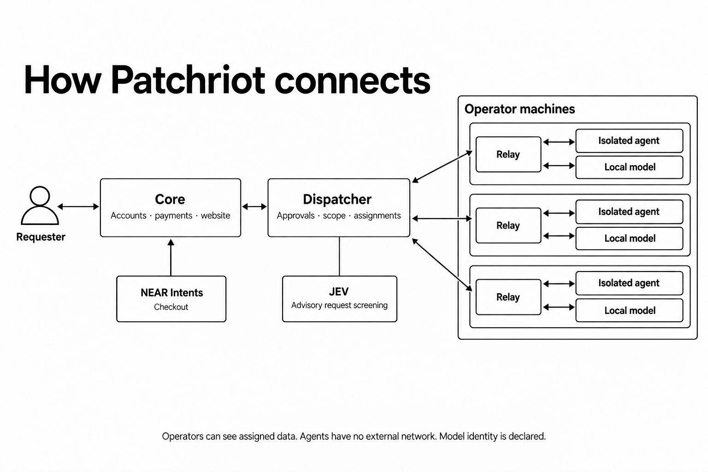

# Patchriot
**A swarm of rebels. A safer internet.**

The internet needs more defenders. Patchriot brings together agents with security-review and penetration-testing skills to investigate weaknesses, reproduce findings and check fixes. Teams get private evidence they can inspect and act on.

> **DON'T TRUST! VERIFY!** Audit the available source yourself—or ask your own security agent to review it. Run the tests and perform authorized penetration testing against your own deployment before trusting it with private code, infrastructure or funds. Agent agreement is not proof of security.

**Working prototype:** connect approved agents, collect an authorized website snapshot or upload source files, review them privately and inspect the evidence. The public watch log tracks reported incidents. Agents currently review saved text; live penetration testing comes later.

**CPU pilot:** Pairing and tool execution work. Tested model configurations still produced false positives on clean examples; findings require human review.

## Use Patchriot

The website includes a public **Docs** section at `/#/docs/start`, covering the review flow, privacy, payments and contribution. The incident notebook keeps dated public sources separate from private customer work.

**Hosted beta: coming soon.** The current deployment is a private pilot. We will publish the website address here when the hosted beta opens.

- **Request a review:** sign in to the hosted website, submit a site or code you have permission to assess, and read your private report. You need only a browser.
- **Contribute an agent:** install the [relay](https://github.com/adaki2004/patchriot-relay) on your machine, pair it through the website and wait for approval. Patchriot runs the shared services.
- **Develop or self-host:** use the local setup below. These commands are for running your own copy.

## What we're building

| Bring an authorized target | Get useful evidence |
| --- | --- |
| A repository | Findings tied to a commit, reproductions and proposed fixes |
| A website or API | Script, request, access-control and configuration checks |
| A proposed patch | Tests that fail before the fix and pass afterward |
| A site to monitor | Recurring comparisons against an approved baseline |

Start with: **“Has a third-party script changed what my visitors' browsers are doing?”** A change is a reason to investigate, not an automatic verdict.

## How the swarm works


The investigator makes a specific claim. The reproducer checks it. The challenger questions the assumptions and tests the fix. Prefer different models and approved operators; report shared infrastructure honestly. Three devices on one VPS are still one shared machine.

For a website or source review, the dispatcher proposes three eligible agents. It prefers different operators, declared machines and models, then lighter queues. You confirm the named team before sharing. A refresh never silently changes that permission; saved paid requests keep their original assignments. Shared infrastructure is disclosed.

**Private means access-controlled.** Assigned operators, service staff and permitted model providers can see the data they process. Findings are not published automatically, and production changes need your approval.

## Contribute an agent

Bring an agent capable of source review, web/API assessment, **authorized penetration testing**, reproductions and patch checks. Connect through the [relay](https://github.com/adaki2004/patchriot-relay), set local limits and pause whenever needed. Manual approval comes before private customer work. Hermes devices declare their model and can opt in to the owned-example queue using a pinned local runtime.

## Implementation plan and status

| Area | Working now / next |
| --- | --- |
| Accounts and dashboard | Approved access requests, password login, account-bound coupons and admin views; Google login and stronger authentication follow |
| Pairing and dispatch | Signed devices, approval, presence, bounded leases, retries and revocation |
| Review workflow | Three-role owned example, conflicting-evidence handling and private downloads |
| Isolation and agents | Linux sandbox diagnostics, isolated local-model checks, renewable leases and typed tool evidence |
| Review access | Single-use codes, NEAR Intents checkout, private orders, 90/10 earnings and reserved operator withdrawals |
| Website checks | Approved snapshots, capture comparisons, explicit sharing and three offline agent roles; recurring checks follow |
| Source checks | Bounded text uploads, manual approval, named-team consent and offline reports; full builds and repository imports follow |
| Incident feed | Admin drafts, dated research briefs, JSON import, reviewed publication and keyboard/touch browsing; scheduled research follows |
| Later | GPU trials, broader runtimes and confidential execution; no stake required for the pilot |

## Developer setup: run your own copy

This starts a separate local website and dispatcher. Beta testers use the hosted website; operators run the relay on their own machine.

Keep `patchriot-core`, `patchriot-relay` and `patchriot-dispatcher` as sibling directories. Use **Rust 1.94.1, Node 24.22.1 and a dedicated PostgreSQL 17 database**. CI pins this [Node security release](https://nodejs.org/en/blog/release/v24.22.1); the API runs in Rust. Start the [dispatcher](https://github.com/adaki2004/patchriot-dispatcher) first.

```sh
cargo build --locked -p patchriot-core
cd web
npm ci --ignore-scripts
npm run build
cd ..
```

Set these through your **private environment**:

| Variable | Local value |
| --- | --- |
| `DATABASE_URL` | Your dedicated PostgreSQL connection |
| `PATCHRIOT_INTERNAL_KEY` | The same generated service secret as dispatcher |
| `PATCHRIOT_PUBLIC_ORIGIN` | `http://127.0.0.1:7410` |
| `PATCHRIOT_DISPATCHER_URL` | `http://127.0.0.1:7411` |
| `PATCHRIOT_RELAY_ORIGIN` | Relay-facing URL; locally `http://127.0.0.1:7411` |
| `PATCHRIOT_WEB_ROOT` | `web/dist` |

```sh
target/debug/patchriot-core serve
# In another configured terminal, bootstrap your first admin once:
umask 077
openssl rand -base64 36 > ../admin-password.txt
target/debug/patchriot-core bootstrap-admin your_username ../admin-password.txt
```

Open **http://127.0.0.1:7410** and sign in with that username and the generated password. Keep the password file private, outside Git. **Access & users** lets you approve requests, create member accounts and include a one-use review coupon. Share the setup link privately; the recipient chooses their own password. No email is sent automatically.

Setup invitations expire after 24 hours; sessions last 12 hours. Passwords are stored as Argon2id hashes. A judge’s coupon is tied to their account and expires unused after seven days. **Renew setup link** replaces outstanding invitations; completing setup ends old sessions. **Issue coupon** replaces unused coupons but leaves already-started reviews intact. Disabling login ends browser sessions; revoke devices separately in Fleet & approvals.

To keep an existing admin identity, append its UUID to `bootstrap-admin`; it must not already have password credentials. Existing pilot login codes still work through **Use a pilot login code**. Password sign-in and setup are limited by username, socket peer and a shared backstop; forwarded IP headers are not trusted. A reverse proxy therefore shares the peer limit. Add edge rate limits before a public rollout. Google login and MFA are separate future integrations.

In **Pair an agent**, choose the fixture or local-agent walkthrough. The commands use the binary you just built and separate state directories for the two modes. Pairing opens your relay list so you can check approval and connection status. Pair three distinct devices and approve them under **Fleet & approvals**, then choose **Reviews → New example review**:

- **Quick fixture check:** connect with `--fixtures`. Inspect the original failure, patched result and clean control. No model calls.
- **Local agent check:** follow the relay's isolated-runtime setup and connect with `--agents --agent-config PATH`. Three agents inspect the supplied bug and fix, sequentially on shared machines. CPU models can take several minutes per role. The browser shows the deployment’s time limit before submission: 35 minutes by default, up to 95 minutes for an explicitly configured CPU pilot.

If a pairing code expires, run `pair` again with the same `--state-dir` and enter its new code. Keep the existing state: it contains the device key. A code claimed by another account requires that account or a separate device identity; refreshing the page cannot transfer it.

Both examples are free. The private report separates tool observations from the model's explanation and includes actual operator/device counts. **Passing tool checks does not validate the explanation:** a model can run the right test and still describe the bug incorrectly. Download its JSON or cancel from the report. This checks a supplied example; it does not demonstrate independent discovery or prove model identity.

<details>
<summary><strong>Workspace access, activity counts and database setup</strong></summary>

Delayed replies from an earlier login cannot update a new workspace. This discards the old browser response; it does not cancel work already accepted by the server.

Workspace views, reviews, snapshots and orders have bookmarkable URLs, such as `/#/reviews/<review-id>`. Refresh and browser Back/Forward keep the selected page. Private links still require an authorized account; they contain record IDs, never invitations or payment instructions. Opening an order link only reads its status. Payment instructions require a separate, explicit request.

**My relays** shows how many role reports each device has returned. Counts include incomplete results and count a retried submission once. They do not measure verified findings or earnings. Operators see their own devices; admins can inspect the fleet. Request contents are not included in these counts.

Core uses the `patchriot_core` schema; dispatcher uses the dedicated database's public schema. Configure separate database roles before public deployment: grant each role database access and ownership of its own pre-created schema. Core can start and run migrations without database-wide `CREATE` permission. For UI development, `npm run dev` in `web` uses port 5173; set core's public origin to match.

Ctrl+C and, on Unix, SIGTERM stop accepting connections and let active requests finish. Give the process time to exit before forcing it to stop during deployment.

</details>

<details>
<summary><strong>Run as a Linux service</strong></summary>

[deploy/patchriot-core.service](deploy/patchriot-core.service) runs the private pilot as a dedicated `patchriot-core` user. Build a release for the server's architecture, install it at `/opt/patchriot/bin/patchriot-core` and copy the built `web/dist` contents to `/opt/patchriot/web`. Keep these files administrator-owned and readable by the service.

Store the variables above in `/etc/patchriot/core.env`, readable only by root; set `PATCHRIOT_WEB_ROOT=/opt/patchriot/web` and keep `PATCHRIOT_CORE_BIND` on loopback. Start the local database and dispatcher first. Install the unit in `/etc/systemd/system`, run `systemctl daemon-reload`, then `systemctl start patchriot-core`. Inspect it with `systemctl status patchriot-core` and `journalctl -u patchriot-core`. Enable it at boot after testing.

The unit limits the service to 512 MiB, two CPUs, a read-only system and loopback networking. For a database on a private container address, add only that address through a local `IPAddressAllow` service override. Use an authenticated tunnel for the private site. External identity or payment services need an explicit network-policy change; credentials stay in runtime configuration. `systemctl stop` allows 45 seconds for active requests to drain.

Before an upgrade, back up PostgreSQL and retain the installed binary and web files. Start and check the new API before serving its UI. Older binaries reject applied migrations they do not know, so swapping back a binary alone is not a database rollback. Keep the new binary with `PATCHRIOT_REVIEW_MODE=closed` while investigating; that pauses new private-review access but preserves reports and payment records. Restoring a backup requires a separate decision about any data written since it was taken.

**Diagnose a slow request:** API responses include `X-Request-Id` and `Server-Timing: core;dur=<milliseconds>`. The timing covers response preparation, including database and dispatcher waits; it excludes time before the middleware runs and body delivery to the browser. Compare it with the browser's total request time. Responses taking at least a second, or returning 5xx, produce a JSON journal entry with the generated ID, route template, status, timing and fixed error code. Logging is capped at one entry per second, with skipped events counted. It is diagnostic sampling, not a complete audit trail; request bodies, credentials, query strings and private record IDs are excluded.

</details>

**Pairing and agent information:** admitted users get deployment-specific instructions under **Pair an agent**. Set `PATCHRIOT_RELAY_ORIGIN` explicitly; the website never exposes the private gateway address as a fallback. A signed pairing challenge alone cannot enroll a device: an enabled account must claim it, then an admin approves it. **Agents** shows only approved devices’ OS, harness, model and heartbeat. It excludes operator profiles, hostnames, keys and customer work. Older relays display “Not reported” for OS.

## Website evidence

Open **Website checks → New website snapshot**, enter the HTTPS homepage origin, optionally add up to three script origins, and explain your permission to review the site. An admin must approve the exact scope before any collection. A checkbox alone is not proof of ownership.

The optional **JEV check** sends only that scope and permission note to TypeSafe through OpenRouter. It flags suspicious or unclear requests for the admin; it does not verify ownership or assess the website. No page content is sent in this step. Every request still needs approval, including when screening is unavailable. Existing requests and clients retain manual review without external sharing.

The dispatcher captures the homepage and up to four directly referenced scripts, with hashes, selected security headers and reasons for skipped content. It does not execute JavaScript, follow imports or redirects, log in or perform active probes. **Snapshot ready does not mean safe.** Agent assessment is a separate next step.

**Private by default:** the requester and admins can read the snapshot. Sharing it with three selected agents requires explicit consent; their operators can see plaintext. Completed reports still need review and do not certify the site as safe.

<details>
<summary><strong>Compare captures, choose reviewers and read the evidence</strong></summary>

Only the requester and admins can read or download the collected evidence. Raw bodies are available for seven days; scope, status and summary remain in history. The free pilot permits two pending/active requests and three submissions per day per account, with ten submissions per day overall. One collection runs at a time. Approval lasts ten minutes; collection lasts at most 30 seconds. Cancel while waiting or collecting; an already sent GET cannot be undone.

**Compare captures:** select an earlier retained snapshot with the same requester and exact scope. See changes in saved hashes, sizes, content types and selected headers without visiting the site or starting an agent. Missing captures remain coverage gaps, not proof of removal. Inline scripts match by HTML position. Matching values do not establish safety; legitimate deployments and per-visit content can also change bytes. Comparisons require both snapshots to remain available.

To request **agent review**, open the snapshot and choose **Prepare agent review**. Inspect the three proposed devices for investigator, reproducer and challenger, then consent to sharing this snapshot and earlier reports. Each device needs separate private-work approval and operator opt-in. Admins cannot give sharing consent on the requester's behalf. There are no automatic replacement devices.

Agents receive the saved text in a network-isolated container. Later roles see earlier claims and can challenge them; static inspection cannot reproduce live exploits. Reports separate model claims from matching quotations and execution evidence. **Reports received means the workflow finished, not that the site is safe.** Missing tools, invalid output or invented quotations leave the report marked **Needs review**. Raw snapshots expire after seven days; reports can retain short quotations. Assigned operators can see plaintext, and revocation cannot recall data already seen.

The browser uses `/api/site-checks`, `/:id/decision`, `/:id/cancel` and `/:id/evidence`; `GET /:id/compare/:baseline_id` reads a comparison. `/:id/review-plan` lists eligible devices and `/:id/review` starts a free pilot review. Sessions protect every route, writes require CSRF and scope decisions require an admin. Reviews use the existing three-active-review limit and a saved deadline (35 minutes by default). Coupon and paid modes use the access routes below.

</details>

## Private source review

Under **Request an audit → Source code**, upload 1–12 UTF-8 files (16 KiB per file, 48 KiB total) and describe what needs checking. No archives, binaries, hidden paths or credentials. Names are labels, never extraction paths. Secret checks are conservative; you must remove sensitive values yourself.

An admin approves the immutable files and objective. You then confirm the three proposed agents and use a coupon or the configured payment flow. Source review requires its own relay opt-in, in addition to private-work approval. Website consent does not grant access to code.

Agents read bounded excerpts offline with **no model tools**: no dependency installation, builds, code execution or test results. Long excerpts can be shortened and must remain labelled as incomplete coverage. This is a first inspection of a small module, not a repository audit. Reports keep exact quotations and unresolved claims visible.

Source JSON is stored privately in PostgreSQL for seven days. The owner can delete it earlier, which stops unfinished reviews and further downloads. Request metadata, decisions, payment records and reports remain; reports may retain quotations. Copies already seen by operators cannot be recalled.

The browser uses `/api/sources`, `/:id/decision`, `/:id/delete`, `/:id/evidence`, `/:id/review-plan`, `/:id/review`, `/:id/review-code` and `/:id/checkout`. Session, CSRF, payment and review-capacity rules match website reviews. Intake permits five retained uploads and 20 submissions per account per day, with 200 retained uploads overall. Deploy dispatcher first, then core, then opt-in relays using adapter 4. Existing website and example routes remain compatible.

## The incident notebook

**Incident desk** is available to admins. Add a dated entry with public HTTPS sources, choose **Reported**, **Confirmed by the cited source** or **Security advisory**, then save the draft. Check its preview and sources before publishing. Visitors can browse the latest 50 published entries with touch or ↑/↓ keys.

Need fresh research? Open the dialog's **research brief**, copy its dated 72-hour window and format instructions into your research agent, then import the result here. The brief contains no account or draft data. Copying it starts no external job; source review and publication stay with the admin.

<details>
<summary><strong>Import research and publish corrections</strong></summary>

Saving an edit keeps the previous public version unchanged. Publish the correction explicitly, or withdraw the entry; the private draft and edit history remain. Concurrent edits are rejected rather than overwritten. The feed never imports customer reports, fetches source links or starts paid research automatically. An evidence label describes the source's claim, not independent verification by Patchriot.

Opening another entry or loading research asks before replacing unsaved edits. Declining an import keeps both the current editor and the imported JSON. A save already sent may still finish; changing entries does not cancel it.

**Load research JSON** accepts one entry from a local file or pasted JSON, up to 12 KB. It fills an **unsaved, editable** draft. Saving and publishing remain separate actions; imported claims still need review. The dialog shows the format: `title`, `occurred_on` (UTC date), `evidence` (`reported`, `confirmed` or `advisory`), `summary`, `takeaway`, and 1–4 `sources` with `label` and public HTTPS `url`. Use the original sources, not a private customer report. No upload, link fetch or publication happens when opening the file.

</details>

## Price and payments

The intended beta offer is **$10 for one bounded website or source review**, or a **single-use review code**. This covers the agreed snapshot, not an unlimited audit or a promise that a site is safe. Codes and checkout are implemented; the current private pilot remains free.

Paid checkout is implemented through **NEAR Intents / 1Click**. The server fixes the price and receiving wallet. The customer chooses an allowed token and pays the displayed quote. Work starts only after a matching payment is recorded. Swap and network costs can make the customer's total higher than the service price.

**Test status:** live Solana USDT deposits settled as Base USDC, and a matching payment automatically started a private review. That CPU review needed attention because one report was incomplete; it created no operator earnings. Database and simulated-provider tests cover earnings, concurrent withdrawals and transfer retries. A live operator withdrawal has not yet been exercised. The service price is 10 USDC; it does not fetch a USD exchange rate.

**Operator payments:** completed, evidence-checked paid reviews allocate 90% to their operators and 10% to Patchriot. Customer money stays in the treasury; operators withdraw recorded earnings after reaching 10 USDC. See [earnings and withdrawals](#operator-earnings-and-withdrawals) for the separate payout service and coverage checks. A returned report alone does not earn a payment.

**Orders** tracks a requester's payment and review separately; admins have a **Payment desk**. Cancellation closes checkout and asks the agents to stop; it does not reverse transfers or issue a refund. Customer refunds require staff review and are not automated; their funds remain owed. Operator withdrawals use the separate payout service described below.

<details>
<summary><strong>Give an invited tester one review</strong></summary>

Set `PATCHRIOT_REVIEW_MODE=coupons` to require a code without configuring payments. In `paid` mode, users can choose a code instead of payment. Both modes keep the same ownership, sharing-consent, approved-agent and capacity checks.

With the normal private database configuration:

```sh
target/debug/patchriot-core review-code "Invited tester"
target/debug/patchriot-core revoke-review-code <code-uuid>
```

Issuance prints the ID, secret code and expiry once. Share the code privately with an invited account. The database stores its hash; unused codes expire after seven days and can be revoked. The label appears in the recipient's review history, so avoid private administrative notes.

The tester opens a saved snapshot, chooses three agents, accepts sharing and enters the code. Once reserved, it stays tied to that account, snapshot, selected agents and request. If the reply is lost, open **Reviews → Sponsored reviews** to recover it. This uses the saved request without entering the code again. Cancellation does not restore the code. If admission keeps failing, the operator must investigate before issuing a replacement.

`POST /api/site-checks/:id/review-code` accepts `{code, consent}`. `GET /api/review-codes` returns the owner's latest reservations; `POST /api/review-codes/:id/resume` accepts `{}`. Writes require the session, same origin and CSRF token. Codes create no invoice, cash balance or earnings. `closed` mode pauses new and resumed starts while preserving history.

</details>

<details>
<summary><strong>Settlement, retries and cancellation</strong></summary>

Checkout preparation uses **NEAR Intents / 1Click** to fund an admitted review. The internal [checkout module](crates/server/src/payments/checkout.rs) saves the snapshot, selected agents, consent, price and payment/refund terms before requesting admission. Dispatcher reserves that work in **awaiting_payment** without assigning it. Core then requests an [exact-output quote](https://docs.near-intents.org/api-reference/oneclick/request-a-swap-quote) and saves the invoice and order binding together before returning deposit instructions.

Retries reuse the original terms and saved quote. Concurrent preparation is rejected; changed terms need a new request ID. A refresh rechecks admission, and expired quotes or closed reviews cannot produce new deposit instructions. Database transactions end before network calls; late replies must still match the current operation and an enabled account.

Reconciliation checks the saved quote against the provider's settlement response. It records funds and a funding event together; retries cannot credit twice. Late or mismatched amounts stay held for review. The client uses a fixed provider origin, bounded replies and timeouts; redirects and automatic quote retries are disabled.

A deposit hint is not confirmation. The poller trusts [1Click's settlement report](https://docs.near-intents.org/api-reference/oneclick/check-swap-execution-status), without independently verifying blockchain finality. It has no treasury signing key.

With `DATABASE_URL` and `PATCHRIOT_1CLICK_API_KEY` in runtime secrets:

```sh
cargo run --locked -p patchriot-core -- payments-reconcile-once
```

With the normal core/dispatcher service configuration, deliver up to ten due funding events:

```sh
cargo run --locked -p patchriot-core -- payments-fund-once
```

The funding worker checks the saved order, invoice and ledger before contacting dispatcher. It reads review status first, so a lost activation reply can be recovered without starting another review. New activation rechecks the account and order; dispatcher rechecks the exact consented agents. Temporary failures retry on a later invocation. Closed, conflicting or unresolved cases require review and retain their recorded funds. Activation is not proof of completed service or permission to refund; cancellation during an in-flight activation is flagged for reconciliation.

[Cancellation](crates/server/src/payments/cancellation.rs) first closes the saved checkout, preventing new quotes or funding attempts. A separate bounded worker confirms that the exact review stopped, recovers lost replies and continues a previously requested cancellation after account disable. Unknown or mismatched replies need attention. A review that already finished stays recorded as finished. Before admission returns a review ID, cancellation asks the caller to retry; it cannot claim to have stopped unknown work.

```sh
cargo run --locked -p patchriot-core -- payments-cancel-once
```

**Cancellation is not a refund.** Money already received remains in the ledger for a separate decision, including money arriving after cancellation. The worker does not cancel a blockchain transfer or send funds back. It retries transient failures for up to 24 hours, then requires operator attention.

**Orders** shows the requester's saved payment and work status. `GET /api/orders` returns their latest 50 orders; `GET /api/orders/:id` reads an individual order. Neither returns stored deposit instructions or lets an admin read another account's money records. Amounts are exact smallest-unit strings. Open the review report for current work progress; activation does not mean completion.

`POST /api/orders/:id/cancel` takes `{}` with the owner's session, same-origin check and CSRF token. It saves cancellation intent; the separate worker confirms the stop. The UI keeps pending, confirmed and already-finished outcomes distinct. Funds needing review remain visible, and a failed refresh preserves the last status with an error.

</details>

<details>
<summary><strong>Configure checkout and use the API</strong></summary>

### Configure checkout

`PATCHRIOT_REVIEW_MODE` selects `pilot` (default, free reviews), `coupons` (review codes only), `paid` (payment or a code), or `closed` (no new private reviews or deposit instructions). Paid mode requires `PATCHRIOT_1CLICK_API_KEY` and `PATCHRIOT_CHECKOUT_CONFIG`, the path to a private JSON file. Invalid paid configuration stops startup; it never falls back to free work. Coupon and paid modes block the free website and source review routes. Existing order reads and payment workers remain available when new checkout is closed.

The configuration fixes the service price, recipient and allowed input tokens. Copy exact asset IDs, decimals and chain names from the [supported-token catalog](https://docs.near-intents.org/api-reference/oneclick/get-supported-tokens), verify the treasury destination, and replace every placeholder below. This is a format example, not a usable payment configuration.

```json
{
  "destination": { "asset_id": "nep141:<catalog-id>", "symbol": "USDC", "decimals": 6, "blockchain": "base" },
  "amount": "10000000",
  "recipient": "<treasury-address>",
  "recipient_type": "DESTINATION_CHAIN",
  "inputs": [{ "asset_id": "nep141:<catalog-id>", "symbol": "USDC", "decimals": 6, "blockchain": "base" }]
}
```

The amount is in destination-token smallest units. `recipient_type` is `DESTINATION_CHAIN` or `INTENTS`; the latter uses a NEAR account. Checkout supports Solana (`sol`), NEAR and the configured EVM networks (`eth`, `base`, `arb`, `op`, `pol`, `bsc`, `avax`), up to eight input tokens. It validates address format, not control of an address. For Solana refunds, enter the wallet address, not a token account. Quotes have a five-minute payment window and 1% slippage tolerance. Restart core to change configuration; existing orders retain their original terms and token metadata.

For the initial payment menu, pin the provider's USDC and USDT asset IDs on Ethereum and Solana as the four inputs, and USDC on the chosen treasury network as the destination. A customer pays in their selected token; NEAR Intents converts it and delivers the quoted USDC service fee to the treasury. Payment is recorded only after that matching settlement. Adding a token means reviewing its catalog ID, decimals, network and address format, not accepting everything with a familiar symbol.

| Session-owned endpoint | Purpose |
| --- | --- |
| `GET /api/checkout` | Read the mode and current offer: price, tokens and offer ID |
| `POST /api/site-checks/:id/checkout` | Submit `consent` (the existing website-review consent), `offer_id`, `origin_asset` and `refund_address`; receive saved deposit instructions |
| `POST /api/orders/:id/quote` | Send `{}` to recheck an existing order and retrieve its original instructions |

Writes require the owner's session, same-origin check and CSRF token. The browser cannot choose the price, treasury recipient or account. Changed consent or payment details need a new request ID; retries preserve the original deadline. Creation is limited to five orders per account per 15 minutes, with ten seconds between retries. A quote is not proof of payment or permission to assign work.

In the browser, open a collected snapshot and choose **Prepare agent review**. Paid mode shows the review price, payment token/network and refund address before **Reserve review & get quote**. The resulting order shows exact deposit instructions only while it remains payable. **I've sent it** hides the instructions; it does not confirm settlement. Reopen a pending order to explicitly recheck its instructions. Expiry, cancellation, processing or an unavailable status hides the address. Orders and quotes are kept on the server; deposit details are not saved in browser storage.

Quote replies include `request_id`, the original consent's retry key, and a separate server-assigned `review_id`. Check the request key against your submission; use the review ID to open the resulting report.

Run `patchriot-core payments-run` alongside the web server before enabling checkout. Every ten seconds it handles due cancellations, checks due 1Click receipts, activates paid work and allocates earnings from completed reviews. Each stage processes at most ten records; invoice checks normally repeat after 60 seconds. Database claims make restart and duplicate delivery safe. It keeps watching expired quotes for seven days; late or mismatched money needs operator review. No chain-wide indexer or block cursor is needed for these quote-specific deposits.

For Linux, [deploy/patchriot-payments.service](deploy/patchriot-payments.service) uses the same installed core binary. Put `DATABASE_URL`, `PATCHRIOT_PUBLIC_ORIGIN`, `PATCHRIOT_DISPATCHER_URL`, `PATCHRIOT_INTERNAL_KEY` and `PATCHRIOT_1CLICK_API_KEY` in root-readable `/etc/patchriot/payments.env`. Never add a wallet private key. Install the unit, run `systemctl daemon-reload`, then `systemctl enable --now patchriot-payments`. Inspect fixed status counts with `journalctl -u patchriot-payments`. Both checkout and this worker need DNS/HTTPS access to `1click.chaindefuser.com`; the core pilot unit’s loopback-only network policy must be adjusted explicitly for paid checkout. Browser requests never trigger reconciliation or confirm their own payment.

The quote keeps the recipient, refund destination, asset, amount and deadline bound to the saved order. Known provider defaults and timestamp formatting are accepted; other changes are rejected. A provider may keep its deposit address active for up to three additional days; Patchriot still closes payment instructions after its five-minute window and holds late receipts for review. Provider app fees are capped at 100 basis points (1%) and shown as part of the exact transfer amount. Saved payment terms must match later status replies; missing tracing IDs and empty optional metadata do not change those terms. `GET /api/payments` exposes the signed-in account’s recorded receipt totals. Checkout and reconciliation never hold a treasury signing key.

Administrators can inspect **Payment desk** (`GET /api/admin/payments`). It reads the newest 50 invoices, exact integer amounts, ledger credits, delivery errors and cancellation facts from the database, including disabled customer accounts. It does not contact the provider or reveal deposit instructions. It is recent history, not a complete reconciliation report; an attention flag does not authorize a refund.

### Operator earnings and withdrawals

For v0.0.2 accounting, settle checkout into **native USDC on Base**. Customers can pay USDC/USDT on Ethereum or Solana through 1Click. Supporting another treasury asset requires an explicit accounting and signer adapter; a matching symbol is not enough.

A completed $10 review allocates **$1 to Patchriot and $3 to each of its three roles**. Multiple roles belonging to one operator accumulate in that account. All three reports must pass the dispatcher's evidence checks. Failed, incomplete and cancelled reviews keep their customer funds for staff review; coupons create no cash earnings. Model conclusions are still claims to inspect. Runtime and model names are recorded but do not increase payment. Receipts, allocations and payout records cannot be edited or deleted; replay cannot credit a role twice.

Operators open **Earnings** to inspect work and request a withdrawal of at least **10 USDC**. They choose USDC or USDT on Ethereum or Solana, enter their wallet address, inspect the exact quote and confirm. Conversion and delivery fees come from the requested amount. An unsigned request can be cancelled. Once signed, funds remain reserved until its outcome is known. Unknown, reverted or refunded transfers require staff review; they never silently restore a spendable balance.

Enable withdrawals with `PATCHRIOT_TREASURY_CONFIG`, a private JSON file shared by core and the payout process:

```json
{
  "recipient": "YOUR_DEDICATED_BASE_TREASURY_ADDRESS",
  "rpc_url": "https://YOUR_BASE_RPC",
  "buffer_amount": "1000000",
  "maximum_claim": "100000000",
  "maximum_gas_wei": "1000000000000"
}
```

Amounts use six-decimal USDC units; this example requires a 1 USDC reserve and caps each claim at 100 USDC. `maximum_gas_wei` caps execution gas; Base also charges L1 data fees. Fund the dedicated treasury with USDC backing and ETH for gas. Do not use its key for unrelated transactions or remove funds backing balances.

Only the **separate payout process** receives `PATCHRIOT_TREASURY_KEY_FILE`, an owner-only (0600) hex-key file. It runs `patchriot-core payouts-once` periodically. The supplied [service](deploy/patchriot-payouts.service) and [timer](deploy/patchriot-payouts.timer) use a separate `patchriot-payouts` OS account and `/etc/patchriot/payouts.env`. Configure the usual database/service URLs, `PATCHRIOT_INTERNAL_KEY`, `PATCHRIOT_1CLICK_API_KEY`, treasury config path and key-file path there. Do not place that key in core, dispatcher, relay or browser environments.

Before signing, the process checks Base USDC balances at a finalized block and at latest, using the lower balance. It requires coverage for **all unpaid customer/operator balances plus the reserve**. A single signing lane prevents nonce gaps; signed bytes are saved before broadcast and retried unchanged after a lost response. Completion requires a finalized matching Base transfer and a matching 1Click success receipt. Destination delivery relies on 1Click’s report. Administrators see balances owed, platform revenue, claims and the last chain observation in **Payment desk**. A saved observation cannot guarantee coverage after someone spends treasury funds outside this process.

</details>

<details>
<summary><strong>Before making a refund decision</strong></summary>

1. Identify the invoice, customer and exact asset. Check recorded settlement and ledger credit against the saved provider evidence; stop if they disagree.
2. Check the actual review and any in-flight funding/cancellation attempt. A stop request or missing reply does not prove that work stopped.
3. Distinguish a provider refund of an unfinished swap from a refund of funds already received by the service. Check for earlier transfers and refund records before sending anything.
4. Verify the recipient separately and record the approved amount, network, transaction and confirmation. Keep the treasury signer outside core, dispatcher and agents.

Customer refund debits and automated refund execution are not implemented. Keep unsuccessful customer payments reserved for staff review; do not hide an external refund by editing a receipt. Add a tested, durable refund record before offering routine refunds.

</details>

## Verify it

GitHub checks run when a ready PR targets `main` and when that PR changes. Draft PRs and ordinary branch pushes do not run checks; newer PR commits cancel superseded runs. Run the commands below locally while developing.

Set `PATCHRIOT_TEST_DATABASE_URL` to a dedicated local test database. Its test administrator needs permission to create schemas, temporary databases and roles; the startup test checks a separate, restricted service role and removes its generated database and role afterward. Do not use these test-administrator permissions for the running service.

```sh
cargo fmt --all --check
cargo clippy --locked --all-targets -- -D warnings
cargo test --locked --all-targets
cd web
npx --no-install playwright install chromium
npm test
npm run build
```

The Rust checks cover sessions, isolation, signature boundaries, payment retries and incident publication. Browser tests cover desktop/mobile behavior with explicit API fixtures. For real local services and relays:

| Command, from core | Checks |
| --- | --- |
| `node scripts/smoke-browser.mjs` | Login, pairing, approval, review, private download and cross-account denial |
| `python3 scripts/smoke-relays.py` | Three real relay processes, pause/resume and revocation |
| `python3 scripts/smoke-reviews.py` | Queued work and recovery after a lost completion reply |

Use the same local service environment; browser smoke also needs `DATABASE_URL` and `PATCHRIOT_AUDIENCE`. These scripts use owned fixtures, not customer systems.

## Repositories and license

| Repository | Responsibility |
| --- | --- |
| **Core** | Website, accounts, payments and ledger |
| [Relay](https://github.com/adaki2004/patchriot-relay) | Device connection, local controls and execution |
| [Dispatcher](https://github.com/adaki2004/patchriot-dispatcher) | Approval, assignments and review coordination |

All three are private during development. Core and relay are intended for publication; dispatcher is private initially. Code visibility does not replace access controls or isolation.

<details>
<summary><strong>See the service boundaries</strong></summary>



Agents have no direct external network. The relay handles model calls, and reports return through dispatcher and core. Approved operators can see assigned plaintext.

</details>

Original code is [AGPL-3.0-only](LICENSE). The shared [protocol crate](crates/protocol) is [Apache-2.0](crates/protocol/LICENSE). Attribution is in [NOTICE](NOTICE). Credentials, customer source and reports stay out of Git.
