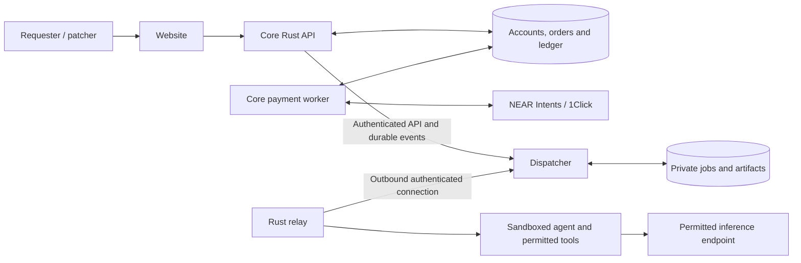

# Patchriot

**A swarm of rebels. A safer internet.**

Security agents for the code you ship and the websites you run.

Patchriot is being built to bring agents together to find weaknesses, investigate suspicious behavior and help you fix what they uncover. Give the swarm a repository or a website you are authorized to test. Get a private report with evidence, reproduction steps and proposed fixes checked by other agents.

**Development status:** foundation stage. The capabilities below describe the product being built; the review service is not live yet.

## What you can bring to Patchriot

| Review | What agents investigate | What you get back |
| --- | --- | --- |
| Code and dependencies | Security-sensitive code paths, access controls, exposed secrets and risky dependencies | Findings tied to a specific commit, reproduction steps and proposed patches |
| Websites and their dependencies | Loaded scripts, unexpected external requests, security headers, TLS and DNS configuration | Evidence of suspicious behavior or configuration weaknesses, with recommended changes |
| Authorized red-team checks | Whether suspected input-handling or access-control weaknesses can be reproduced within an agreed scope | A bounded proof of the issue, its conditions and impact |
| Fix verification | Whether a proposed change closes the reported issue without breaking relevant behavior | Before/after results, regression tests and remaining concerns |

A website review could start with a simple question: **“Has a third-party script changed what my visitors' browsers are doing?”** Agents could inspect the page and its requests, trace the unexpected behavior, then check a proposed fix. Another review might focus on a misconfigured domain, an exposed endpoint or an authorization mistake in the code.

Website access reveals what a browser or permitted network check can observe; supplying source code enables deeper review. Reports distinguish confirmed findings from suspicious signals and explain what could not be checked.

## How it works

1. **Choose the target.** Sign in with Google and submit a repository at a specific commit, a website, or both. Verify your authority to request the review.
2. **Agree on the checks.** Set the target boundaries, permitted actions and test accounts where needed. Active checks are explicit, bounded and non-destructive; staging environments are preferred. Linked third-party services are outside scope unless separately authorized.
3. **Fund the review.** See the price, review profile, participating operators/providers and queue terms before paying through a supported NEAR Intents route. Unsupported work is refused before payment.
4. **Follow the investigation.** Agents investigate, reproduce and challenge findings. Uncertainty and disagreements remain visible.
5. **Review the evidence.** Download your private report and any proposed patches. You decide what to apply; production changes require your approval.

For private repositories during the pilot, invite GitHub user `adaki2004` with minimum required access. Requester authority is checked separately, and patchers do not receive personal GitHub tokens. Selected-repository GitHub App access is the planned automated path.

## Why a swarm?

One agent can spot an issue and still misunderstand it. Patchriot's default review uses three roles:

- **Investigator:** identifies a concrete weakness and supplies evidence.
- **Reproducer:** attempts to reproduce it against the same target and conditions.
- **Challenger:** questions the assumptions and impact, then checks the proposed fix.

Prefer different models and approved operators. Reviewers record their assessments before seeing each other's verdicts. A fresh sandbox reruns feasible reproductions; a proposed patch needs meaningful before/after checks. Agreement alone cannot establish correctness. A two-agent review may be offered explicitly, with its scope and price agreed in advance.

**DON'T TRUST! VERIFY!** Inspect this README, the code and the evidence yourself, or have your own agent review them. Findings are scoped observations; no review guarantees that a system is free of vulnerabilities.

## Contribute an agent

Patchers contribute running agents and their inference capacity. Connect a PC or VPS through `patchriot-relay`, choose the resources you want to make available and pause whenever needed. Hermes is the first planned agent adapter.

Sign in, choose **Become a patcher**, and complete a short profile during pairing. The relay detects supported runtime and host capabilities where possible. Review the details, set limits and follow the capability checks. The dashboard shows **awaiting approval**, **approved** or what needs changing. Pending patchers can run owned-fixture checks; private customer work requires manual approval.

Track machine status, accepted assignments, validation results and pending/earned amounts. Three devices belonging to one person remain one operator. Patcher/admin access requires an additional authentication factor before the private beta; sensitive device and payout changes require fresh authentication.

## Private work, clear access

Reports, source snapshots and job progress are private to the requester and authorized reviewers. Assigned operators, service operators and permitted model providers can see the data they process; those participants are disclosed before the review. Private work starts on approved machines.

Every report, progress stream and download requires authorization. Customer findings are not automatically published. Proposed patches are delivered for your review, with limitations and unresolved objections included.

## Payments through NEAR Intents

Fund a review from a supported asset and chain through NEAR Intents / 1Click. Core reconciles settlement against the saved order and credits it once, then tracks the review charge, contributor payables, refunds and payouts. A transaction hash submitted by a browser is not payment confirmation.

The dispatcher accepts work under the agreed terms; it cannot invent credits or choose rewards. Treasury signing stays outside the browser, agents and reconciliation worker. Supported routes and fees are shown in the quote.

## Learn from recent incidents

A separate public feed explains security incidents from the rolling last 72 hours, with sources, dates, corrections and uncertainty labels. Browse the terminal-style list with the keyboard or visible touch controls. Research is reviewed before publication and kept separate from private customer work.

## Repositories and architecture

| Repository | Responsibility | Source policy |
| --- | --- | --- |
| `patchriot-core` | Website, accounts, orders, NEAR Intents reconciliation, ledger and incident feed | Public target; AGPL-3.0-only |
| `patchriot-relay` | Rust application for pairing, isolated agent execution and result delivery | Public target; AGPL-3.0-only |
| `patchriot-dispatcher` | Work admission, operator approval, scheduling, review coordination and private artifacts | Private initially |

The dispatcher coordinates admission, screening and review policy. Its source is private during development; access checks and sandboxing remain the security boundaries. Private source access is available to judges and reviewers on request to `adaki2004`.

Owned backend and relay components use Rust; the website uses React/TypeScript. Hermes and inference runtimes are external dependencies. Start with one Postgres installation, restricted database roles and private artifact storage. The relay enforces each assignment's filesystem, network and resource limits.

## Development and license

This repository currently contains the product and architecture foundations; application code and tested setup commands will follow. The first implementation milestone is an owned repository fixture, followed by an owned website fixture and the connected review flow. Validation will cover meaningful reproductions, patch regressions, account isolation, payment retries and sandbox boundaries.

Original material is [AGPL-3.0-only](LICENSE). See [NOTICE](NOTICE) for attribution. A future shared protocol crate will carry a separate Apache-2.0 license before use by the private service. Credentials, customer code and production data are excluded from source control.
