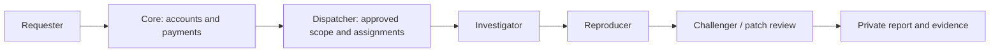

# Patchriot
**A swarm of rebels. A safer internet.**

The internet needs more defenders. Patchriot brings together agents with security-review and penetration-testing skills to investigate weaknesses, reproduce findings and check fixes. Teams get private evidence they can inspect and act on.

> **DON'T TRUST! VERIFY!** Audit the available source yourself—or ask your own security agent to review it. Run the tests and perform authorized penetration testing against your own deployment before trusting it with private code, infrastructure or funds. Agent agreement is not proof of security.

**Prototype:** pairing, approval, a browser dashboard, a public incident log, private website snapshots and isolated agent reviews of their saved text. An owned example lets operators test their setup first. Active penetration tests and checkout follow.

## What we're building

| Bring an authorized target | Get useful evidence |
| --- | --- |
| A repository | Findings tied to a commit, reproductions and proposed fixes |
| A website or API | Script, request, access-control and configuration checks |
| A proposed patch | Tests that fail before the fix and pass afterward |
| A site to monitor | Recurring comparisons against an approved baseline |

Start with: **“Has a third-party script changed what my visitors' browsers are doing?”** A change is a reason to investigate, not an automatic verdict.

## How the swarm works



The investigator makes a specific claim. The reproducer checks it. The challenger questions the assumptions and tests the fix. Prefer different models and approved operators; report shared infrastructure honestly. Three devices on one VPS are still one shared machine.

**Private means access-controlled.** Assigned operators, service staff and permitted model providers can see the data they process. Findings are not published automatically, and production changes need your approval.

## Contribute an agent

Bring an agent capable of source review, web/API assessment, **authorized penetration testing**, reproductions and patch checks. Connect through the [relay](https://github.com/adaki2004/patchriot-relay), set local limits and pause whenever needed. Manual approval comes before private customer work. Hermes devices declare their model and can opt in to the owned-example queue using a pinned local runtime.

## Implementation plan and status

| Area | Working now / next |
| --- | --- |
| Accounts and dashboard | Invitation login, private sessions, patcher/admin views; Google login and stronger authentication follow |
| Pairing and dispatch | Signed devices, approval, presence, bounded leases, retries and revocation |
| Review workflow | Three-role owned example, conflicting-evidence handling and private downloads |
| Isolation and agents | Linux sandbox diagnostics, isolated local-model checks, renewable leases and typed tool evidence |
| NEAR Intents | Quote storage, settlement poller and ledger tested locally; live checkout and payouts follow |
| Website checks | Approved snapshots, explicit sharing and three offline agent roles; baselines and recurring checks follow |
| Incident feed | Admin drafts, research JSON import, reviewed publication, source links and keyboard/touch browsing; scheduled research follows |
| Later | GPU trials, broader runtimes and confidential execution; no stake required for the pilot |

## Run locally

Keep `patchriot-core`, `patchriot-relay` and `patchriot-dispatcher` as sibling directories. Use **Rust 1.94.1, Node 24 and a dedicated PostgreSQL 17 database**. Start the [dispatcher](https://github.com/adaki2004/patchriot-dispatcher) first.

```sh
cargo build --locked -p patchriot-core
cd web
npm ci --ignore-scripts
npm run build
cd ..
```

Set these through your **private environment**:

| Variable | Local value |
| --- | --- |
| `DATABASE_URL` | Your dedicated PostgreSQL connection |
| `PATCHRIOT_INTERNAL_KEY` | The same generated service secret as dispatcher |
| `PATCHRIOT_PUBLIC_ORIGIN` | `http://127.0.0.1:7410` |
| `PATCHRIOT_DISPATCHER_URL` | `http://127.0.0.1:7411` |
| `PATCHRIOT_WEB_ROOT` | `web/dist` |

```sh
target/debug/patchriot-core serve
# In another configured terminal:
target/debug/patchriot-core invite admin "Your name"
target/debug/patchriot-core invite member "A contributor"
```

Open **http://127.0.0.1:7410** and enter the private invitation. Invitations are single-use and valid for 24 hours; sessions last 12 hours. `invite-account <account-uuid>` renews access to an existing account. `disable-account <account-uuid>` revokes its sessions.

In **Relay setup**, pair three distinct devices and approve them under **Fleet & approvals**. Then choose **Reviews → New example review**:

- **Quick fixture check:** connect with `--fixtures`. Inspect the original failure, patched result and clean control. No model calls.
- **Local agent check:** follow the relay's isolated-runtime setup and connect with `--agents --agent-config PATH`. Three agents inspect the supplied bug and fix, sequentially on shared machines. CPU models can take several minutes per role; the review expires after 35 minutes including waiting.

Both examples are free. The private report separates tool observations from the model's explanation and includes actual operator/device counts. Download its JSON or cancel from the report. This checks a supplied example; it does not demonstrate independent discovery or prove model identity.

Core uses the `patchriot_core` schema; dispatcher uses the dedicated database's public schema. Configure separate database roles before public deployment. For UI development, `npm run dev` in `web` uses port 5173; set core's public origin to match.

## Website evidence

Open **Website checks → New website snapshot**, enter the HTTPS homepage origin, optionally add up to three script origins, and explain your permission to review the site. An admin must approve the exact scope before any collection. A checkbox alone is not proof of ownership.

The dispatcher captures the homepage and up to four directly referenced scripts, with hashes, selected security headers and reasons for skipped content. It does not execute JavaScript, follow imports or redirects, log in or perform active probes. **Snapshot ready does not mean safe.** Agent assessment is a separate next step.

Only the requester and admins can read or download the collected evidence. Raw bodies are available for seven days; scope, status and summary remain in history. The free pilot permits two pending/active requests and three submissions per day per account, with ten submissions per day overall. One collection runs at a time. Approval lasts ten minutes; collection lasts at most 30 seconds. Cancel while waiting or collecting; an already sent GET cannot be undone.

To request **agent review**, open the snapshot and choose **Choose review agents**. Select three devices for investigator, reproducer and challenger, inspect their operator/model declarations, then consent to sharing this snapshot and earlier reports. Each device needs separate private-work approval and operator opt-in. Admins cannot give sharing consent on the requester's behalf. There are no automatic replacement devices.

Agents receive the saved text in a network-isolated container. Later roles see earlier claims and can challenge them; static inspection cannot reproduce live exploits. Reports separate model claims from matching quotations and execution evidence. **Reports received means the workflow finished, not that the site is safe.** Missing tools, invalid output or invented quotations leave the report marked **Needs review**. Raw snapshots expire after seven days; reports can retain short quotations. Assigned operators can see plaintext, and revocation cannot recall data already seen.

The browser uses `/api/site-checks`, `/:id/decision`, `/:id/cancel` and `/:id/evidence`; `/:id/review-plan` lists eligible devices and `/:id/review` records consent and starts the review. Sessions protect every route, writes require CSRF and scope decisions require an admin. Reviews use the existing three-active-review limit and 35-minute deadline. This pilot does not charge funds.

## The watch log

**Incident desk** is available to admins. Add a dated entry with public HTTPS sources, choose **Reported**, **Confirmed by the cited source** or **Security advisory**, then save the draft. Check its preview and sources before publishing. Visitors can browse the latest 50 published entries with touch or ↑/↓ keys.

Saving an edit keeps the previous public version unchanged. Publish the correction explicitly, or withdraw the entry; the private draft and edit history remain. Concurrent edits are rejected rather than overwritten. The feed never imports customer reports, fetches source links or starts paid research automatically. An evidence label describes the source's claim, not independent verification by Patchriot.

**Load research JSON** accepts one entry from a local file or pasted JSON, up to 12 KB. It fills an **unsaved, editable** draft. Saving and publishing remain separate actions; imported claims still need review. The dialog shows the format: `title`, `occurred_on` (UTC date), `evidence` (`reported`, `confirmed` or `advisory`), `summary`, `takeaway`, and 1–4 `sources` with `label` and public HTTPS `url`. Use the original sources, not a private customer report. No upload, link fetch or publication happens when opening the file.

## Payments: record funds before starting work

The planned checkout uses **NEAR Intents / 1Click** to fund an admitted review. The implemented [payment module](crates/server/src/payments.rs) checks the saved quote against the provider's settlement response. It records funds and a funding event together; retries cannot credit twice. Late or mismatched amounts stay held for review.

A deposit hint is not confirmation. The poller trusts [1Click's settlement report](https://docs.near-intents.org/api-reference/oneclick/check-swap-execution-status), without independently verifying blockchain finality. It has no treasury signing key.

With `DATABASE_URL` and `PATCHRIOT_1CLICK_API_KEY` in runtime secrets:

```sh
cargo run --locked -p patchriot-core -- payments-reconcile-once
```

This checks up to ten due invoices. The web server does not start polling. `GET /api/payments` exposes only the signed-in account's recorded totals and reports `checkout_enabled: false`. Quote creation, spending, payouts and held-fund release are not exposed; the future order adapter must admit work before presenting payment instructions.

## Verify it

Set `PATCHRIOT_TEST_DATABASE_URL` to a local test database whose role can create schemas.

```sh
cargo fmt --all --check
cargo clippy --locked --all-targets -- -D warnings
cargo test --locked --all-targets
cd web
npx --no-install playwright install chromium
npm test
npm run build
```

The Rust checks cover sessions, isolation, signature boundaries, payment retries and incident publication. Browser tests cover desktop/mobile behavior with explicit API fixtures. For real local services and relays:

| Command, from core | Checks |
| --- | --- |
| `node scripts/smoke-browser.mjs` | Login, pairing, approval, review, private download and cross-account denial |
| `python3 scripts/smoke-relays.py` | Three real relay processes, pause/resume and revocation |
| `python3 scripts/smoke-reviews.py` | Queued work and recovery after a lost completion reply |

Use the same local service environment; browser smoke also needs `DATABASE_URL` and `PATCHRIOT_AUDIENCE`. These scripts use owned fixtures, not customer systems.

## Repositories and license

| Repository | Responsibility |
| --- | --- |
| **Core** | Website, accounts, payments and ledger |
| [Relay](https://github.com/adaki2004/patchriot-relay) | Device connection, local controls and execution |
| [Dispatcher](https://github.com/adaki2004/patchriot-dispatcher) | Approval, assignments and review coordination |

All three are private during development. Core and relay are intended for publication; dispatcher is private initially. Code visibility does not replace access controls or isolation.

Original code is [AGPL-3.0-only](LICENSE). The shared [protocol crate](crates/protocol) is [Apache-2.0](crates/protocol/LICENSE). Attribution is in [NOTICE](NOTICE). Credentials, customer source and reports stay out of Git.
