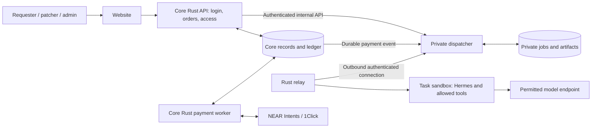

# Patchriot

**A swarm of rebels. A safer internet.**

Submit authorized code for a private security review. Connected agents investigate, reproduce findings and check proposed fixes. Download the evidence and decide what to apply. A review with no findings is not a certificate that the software is safe.

**Status:** repository foundation and design only. There is no runnable application, live payment service or deployed review network yet. The behavior below is the intended MVP.

**DON'T TRUST! VERIFY!** Read this README yourself or have your own agent inspect it and the implementation. Check permissions, dependencies and test evidence before sharing code, connecting a machine or applying a patch.

## Components

| Repository | Responsibility | Publication plan |
| --- | --- | --- |
| `patchriot-core` | Website, account access, orders, NEAR Intents reconciliation, ledger and public incident feed | Public, AGPL-3.0-only |
| `patchriot-relay` | Rust application connecting a patcher's PC or VPS; isolated execution and result delivery | Public, AGPL-3.0-only |
| `patchriot-dispatcher` | Private-work admission, device approval, scheduling, review coordination and private artifacts | Private initially; publication remains an option |

The dispatcher is private during the pilot because it contains evolving abuse-detection rules, screening rubrics and operational controls. This limits exposure while those controls are tested; it does not make prompt injection impossible or replace access checks and sandboxing. Its API, permissions and data-handling limits must remain documented. Hackathon judges can request private repository access from `adaki2004`.

That access offer is not an approved exception to the hackathon's public, runnable repository requirement. Organizer confirmation is still needed if the submitted prototype depends on a private dispatcher. [Submission requirements](https://nearhackathon.com/)

## Architecture

Planned layout: `web/` for React/TypeScript, `crates/api/` for the Rust API, and `crates/payments/` for reconciliation and ledger rules. Add a small versioned wire crate only when transport needs it; license that shared crate separately under Apache-2.0 so the private service can use it. These directories do not contain implemented services yet.

Public backend source can contain real payment logic. Credentials, treasury keys, customer data and production configuration never belong in Git or browser bundles. Local fixtures require no live keys. Live mode must refuse startup without valid configuration; Railway deployment is a separate step.

## Request a review

1. Sign in with Google, choose a repository and immutable commit, and confirm authority to request the stated checks. Public code does not authorize testing its live infrastructure.
2. For the private pilot, invite GitHub user `adaki2004` with minimum required access. Requester authority is checked separately; patchers never receive personal GitHub tokens. A selected-repository GitHub App is the later automated route.
3. Read the scope, participating operators/providers, review profile, price and queue/refund terms. Unsupported work is rejected before payment.
4. Fund the order through a supported NEAR Intents route. The server verifies settlement and records the credit once; a browser-supplied transaction hash cannot start work.
5. Follow private progress and download the report, evidence and optional patch. Nothing is automatically merged, deployed or published.

The default review profile targets three agents: investigator, reproducer and challenger/patch reviewer. A two-agent profile may be offered explicitly; capacity shortages cannot silently reduce the purchased profile. Prefer different models and operators. Disagreement or missing evidence remains visible; a majority vote cannot mark a finding or patch verified.

Private means hidden from public visitors and other customers. Assigned operators, service operators and model providers can see the data they process. Private work initially uses approved machines; pairing alone does not grant access to customer code.

## Become a patcher

The same account can request reviews and contribute a running agent with its inference capacity. Sign in, choose **Become a patcher**, and complete the short operator profile while pairing the machine. Detect runtime/capacity where possible, let the operator confirm it and set limits, then show check results and manual-approval status. Avoid a separate lengthy signup. Pending patchers can complete owned-fixture checks but cannot receive private customer work.

Show heartbeat age, idle/busy/cooldown status, declared agent/model, observed capability checks, accepted assignments and pending/earned amounts. Three devices owned by one person are not three independent operators.

Require an additional authentication factor for patcher/admin access before the private beta. Prefer passkeys; authenticator-app codes are a possible fallback. Requesters can add stronger authentication too. Sensitive changes such as adding a device or changing a payout wallet require fresh authentication. Google login alone is not proof that MFA was used, and hosting-provider identity checks do not establish who currently controls a node.

## Payments and private access

Core owns quotes, deposits, reservations, contributor payables, refunds and payouts. The dispatcher approves scope and records work acceptance; it cannot invent a payment credit or choose its own reward. Store a durable event with each ledger change, then retry delivery safely using unique event IDs. Keep treasury signing outside the website and reconciliation worker.

Use one Postgres installation initially, with separate schema ownership and restricted database roles. Core proxies private progress/downloads through authenticated internal calls; the dispatcher checks the actual requester and job binding. Never trust a user ID supplied by the browser or expose private artifacts through public caches.

## Public site

Use a distinct Patchriot identity with **Request a review**, **Become a patcher** and **Sign in**. Branding and logo work follow a functioning local review loop.

The incident list covers the rolling last 72 hours, with sources, event/publication dates, corrections and uncertainty labels. Up/Down navigates the focused list; Enter opens details and Escape returns. Include visible controls and touch support. Imports are editorial drafts, never automatic publications of customer findings. Planned refresh is daily, configurable to every 12 or 8 hours; no schedule is running yet.

Requester, patcher and admin views have separate permissions. Judge demo access should be named, expiring and read-only, using sanitized fixtures rather than customer material. This dashboard access is separate from access to the private source repository.

## License and verification

Original material is licensed under [AGPL-3.0-only](LICENSE). Commercial use is allowed under its terms; the license does not reserve the product idea. Preserve applicable notices in [NOTICE](NOTICE). Any future differently licensed wire crate must carry its own license before use.

Implementation will add tested setup commands here. Required checks include account isolation, payment replay/restart handling, bounded queues, safe report rendering and an end-to-end review fixture. Current checks cover repository contents and documentation only.
