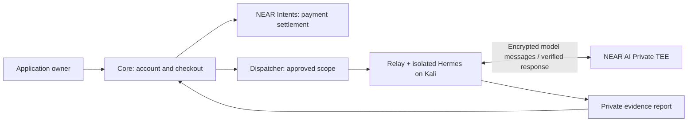
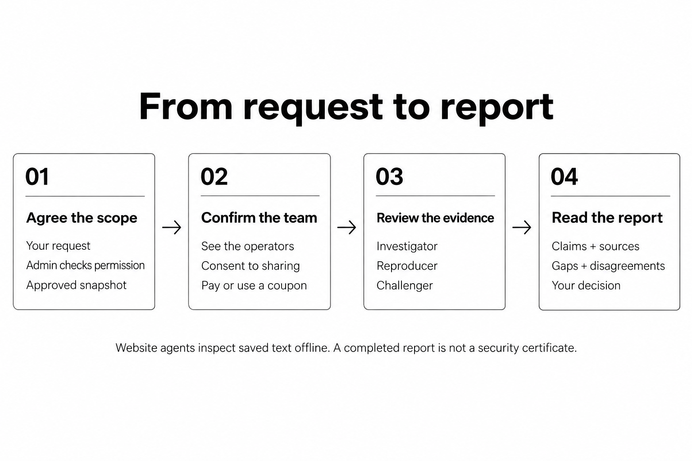

# Patchriot
**Defense before you ship.**

Patchriot runs managed security assessments for web applications. Verify your own domain, start a bounded test and inspect private findings with recorded evidence. Businesses can arrange a dedicated installation.

> **DON’T TRUST! VERIFY!** Read the public source—or ask your own security agent to review it. Test your own deployment before sharing private material. Agent agreement is not proof of safety.

## First product

Our **web application assessment** is an automated first check before a human penetration test. Only test websites and systems you own and control. Enter their public HTTPS URL, prove domain control with a temporary DNS TXT record, and confirm the team and model-provider access. Successful DNS verification opens checkout automatically; staff can still block a request. Reports retain the recorded requests, findings and incomplete checks. The report separates numbered findings, each agent’s contribution, coverage and technical evidence. Missing assessments and execution limits stay visible; agent agreement is not presented as independent confirmation. The progress bar counts saved role reports, not elapsed time or estimated website coverage.

Repeat findings appear once in the report, with each agent’s contribution and request references retained. Grouping requires matching titles and the same first cited request, including its method, URL and body inputs. Anonymous and test-account checks appear inside the same observation, with each access context labelled. Different severity or support stays marked for review; the highest reported severity is shown. Uncertain matches stay separate. PDF and Markdown use the same grouping; the evidence JSON preserves the original reports.

The pilot is read-only by default. Dedicated test accounts can extend access through cookie-based form/JSON login, HTTP Basic or a bearer token. An explicit disposable-environment option permits bounded POST tests. Interactive browser login, SSO, MFA, load tests and fund movement are unsupported. This is an automated first assessment, not complete OWASP coverage or certification.

| Assessment | What you provide | Status |
| --- | --- | --- |
| **Black box** | A website or API URL and proof of control | First product |
| **Grey box** | The URL and a dedicated test account | Cookie-based form/JSON login, HTTP Basic or bearer token; no interactive browser login |
| **White box** | Source code plus an approved test environment | Planned; existing source-text review is a separate, limited tool |
| **Dedicated installation** | Business requirements, hosting and access rules | By arrangement |

Private repository access is planned through a GitHub App installed on selected repositories, with read-only source access and a fixed commit for each assessment. Repository access does not authorize testing a deployed site. Source-assisted testing still needs explicit target scope and consent to share code with the selected operators and model provider.

**Discovery tools** include an adapted ARTEX engine in every new website request made through the UI. We reuse its pinned planner and tools inside Patchriot’s restricted runner; this is not an unrestricted ARTEX deployment. Checkout requires a team of three compatible agents; older saved requests keep their original tool selection. With relay adapter 9, Scout runs the discovery scanners and engine once. Recon and Verifier use that record to choose fresh, targeted checks instead of repeating the full scan. The pinned engine runs inside the task container and shares the assessment's existing budgets. Only approved HTTP methods can reach the target. The report records tool versions, requests, output and early stops. This does not run every upstream skill or optional tool. An interrupted discovery run keeps its evidence and leaves the overall assessment marked for review, even when later roles finish.

| Service | Who it is for |
| --- | --- |
| **Managed assessments** | Application owners. Patchriot operates the agents; users need only a browser and domain-control proof. Reports stay private. |
| **Dedicated installations** | Businesses with separate services, agents, storage and agreed access rules. Setup is arranged with the team, not created automatically. |

**Pairing is staff-only.** Public machines cannot join the managed service. Administrators connect the agents we operate. Existing approved devices continue to work. Relay connection details are available only to administrators, and the browser never receives the private core-to-dispatcher address.

## Private inference with NEAR AI

NEAR-backed agents use **DeepSeek V4.1 Flash 1017 Abliterated** on the [Private TEE route](https://near.ai/models/deepseek-ai/DeepSeek-V4.1-Flash-1017-abliterated). The relay encrypts model messages, verifies the execution environment and checks signed responses before passing them to the agent. [NEAR AI](https://near.ai/) states that private inference does not log prompts or responses.

This protects the model step, not the entire agent machine. Approved operators handle task content, and Patchriot stores reports under its own deletion policy. Previously saved reviews retain their disclosed providers; inspect them before consenting. See [privacy and retention](https://patchriot.tech/#/docs/privacy) and the [testing FAQ](https://patchriot.tech/#/docs/safety).

## Components

| Repository | Responsibility |
| --- | --- |
| **patchriot-core** | Website, accounts, NEAR Intents checkout, accounting and shared API types |
| **patchriot-dispatcher** | Ownership checks, staff approval, assignments and private evidence |
| **patchriot-relay** | Connects managed Kali agents; bounds tool access and verifies encrypted NEAR AI inference |

Core is the product and integration entry point. Dispatcher and relay are separate repositories, currently private. Repository privacy does not protect runtime data; access controls, scope checks and isolation do. Deployment keys and customer records never belong in any repository.



The TEE covers model inference. The managed agent and its operator handle task content outside it. A dedicated business installation uses this same separation with its own services and storage.

## Use Patchriot

Open **App** to sign in with GitHub or Google. Existing pilot accounts can still use their password. The dashboard brings together your requests, reports and payments. **Audits** links each scope to its reports; **Administration** shows network activity and staff controls. Recent events are separately reviewed public research, never customer findings.

For a live website test:

1. Enter your own website URL and confirm that you own and control the target system. The server supplies the versioned `web_baseline_v1` plan: reachable pages and forms, exposed configuration, directory listings, browser policy, cross-origin behavior and safe query probes. The scope covers that exact host; a different subdomain needs its own request.
2. Add the supplied TXT record for every domain. New requests allow up to seven days to arrange this; **Copy instructions for my developer** prepares the values to share. Select **Check DNS record** after the record is saved; the server checks for up to five minutes. The page shows the last lookup and remaining time, then offers a retry if no match was found. Returning from your DNS provider’s tab refreshes the status. A repeated click does not extend the window.
3. Wait for domain verification, then confirm the named operators and disclosed model provider. Use a coupon or pay the quoted fee when checkout is enabled. Work queues automatically after access is confirmed.
4. Inspect the private report, including evidence, gaps and disagreement. Download a PDF with a summary, scope, findings, recommendations, coverage limits and tool register. The PDF is generated in your browser without sending the report elsewhere. Markdown, original evidence JSON and a Postman inventory remain available under other downloads. The inventory omits query values and headers; it does not infer a complete API schema or prove access-control flaws.

Public HTTPS websites and APIs are supported. Knowing a raw IP address or controlling reverse DNS is not proof that you own a server. General port scans and non-web services need a separate infrastructure-verification and testing policy; they are outside this product.

DNS proof belongs to this account and exact request. New requests allow up to seven days for setup. Successful verification narrows permission to at most 24 hours, capped by the saved expiry. A proof cannot authorize another request or testing on other domains. Each request allows six refresh windows. Normal DNS propagation may take longer than one window. Access is rechecked when work starts and workers request evidence.

Staff can explicitly authorize a configured owned test site for development. This is recorded separately from DNS proof, expires, and can be revoked. It does not start work, replace requester consent or bypass payment. Public requests still require DNS verification.

**Hosted pilot:** [patchriot.tech](https://patchriot.tech). Accounts require approval. Features on a development branch may not be deployed yet; the website shows the options currently available. The local instructions below run a separate installation.

## Enterprise inquiries

Use **Discuss a dedicated setup** on the homepage to discuss a separate business installation. The form saves the inquiry in **Administration → Contact inbox**; it does not send automated email, create an account or approve testing. Only administrators can read or mark inquiries handled. Set `PATCHRIOT_CONTACT_EMAIL` to an inbox you operate to also show a public email link. When unset, the form remains available without inventing an address.

The form accepts 10 submissions per socket peer per 15 minutes, 100 globally per 15 minutes and three per email per day. Caller-supplied forwarding headers cannot bypass these limits. Behind a proxy, the peer limit is shared. Contact and sign-in limits are separate.

## How reviews work

Finished website reports can offer an **optional NEAR AI report check** when dispatcher enables it. With the requester's consent, a separate model reviews finding excerpts for possible duplicates and unsupported claims. This advice does not change findings or run more tests. Download its signed input/output receipt from the same report; that export starts the same 12-hour deletion clock. Verification covers that model response, not the Kali agents, a particular physical machine or the truth of the findings. Finding excerpts can contain sensitive details, even though raw HTTP captures and saved login credentials are excluded.



An investigator makes a claim, a reproducer checks it and a challenger questions it. Prefer different operators and models; disclose shared infrastructure. Three devices on one VPS are one shared machine, not three independent operators.

New live tests run ready requests in order on each shared machine, with one active assignment at a time. Paid requests join that order when payment is confirmed. Waiting does not spend an agent's execution allowance: its clock starts when assigned. The report shows waiting, the active agent's deadline and the separate request expiry. Requests remain valid for at most 24 hours after admission or payment, and stop sooner if domain permission or test-account access expires. An unavailable assigned agent can be skipped in favor of other ready work; no replacement operator is silently added. Existing requests keep their original deadlines.

**Private means access-controlled.** Assigned operators, service staff and consented model providers can see the data they process. Findings are not published automatically. The beta has produced incomplete reports and false positives, which remain visible for review.

Live evidence allows up to 4 MiB of compact JSON per agent report. The full three-role report, downloads and internal payment/reward reads accept that combined size. Lists omit report bodies. The PDF remains a readable summary; original recorded evidence is in the JSON export. HTTP capture and excerpt limits still apply and shortening is marked explicitly.

## Report downloads and deletion

The requester’s first export of a finished report starts a fixed 12-hour deletion timer. PDF, Markdown, endpoint and evidence JSON exports all use the same authenticated `POST /api/reviews/:id/report` with `{}`, the session cookie, allowed Origin and CSRF token. A GET does not start an export. The timer records server acceptance, not confirmation that the browser saved the file. Repeated downloads never extend it; ordinary reads and staff exports do not start it.

At expiry, report reads hide findings, HTTP evidence and tool output immediately. Dispatcher cleanup removes those fields from active storage within its next successful 30-second sweep. Small work receipts preserve earnings accounting; job state, consent, hashes and payment records remain. Browser-generated exports are not stored on the server. Existing reports acquire a deadline only when the requester exports them. Source uploads and snapshots retain their separate seven-day policy. Downloaded/operator/provider copies and database recovery media are outside this application-level deletion; configure and document backup retention for the deployment.

Deploy dispatcher and its migration before core. Clients using the previous GET download route must use the explicit POST; this prevents prefetching or cross-site links from starting deletion.

## Optional public page counts

**Off by default.** Set `PATCHRIOT_ANALYTICS_ENABLED=true`, `PATCHRIOT_GA_MEASUREMENT_ID` and `PATCHRIOT_ANALYTICS_ORIGIN` to offer opt-in Google Analytics. Old measurement settings alone do not enable it. Leave the switch unset or set it to `false` to disable all analytics routes and delivery. Job, payment and service metrics do not require Google Analytics.

The analytics origin must use a different hostname, routed to this same core service; it serves only the analytics frame, with all app and account routes blocked. A different port on the app hostname is insufficient. Only signed-out visits to Home, Docs and Recent events qualify; opening sign-in or private work removes the frame. **Privacy choices** lets visitors decline or withdraw consent. The choice stays in local storage for 180 days, without a user identifier.

Google's script runs in a sandbox on that separate hostname. It cannot read the app document, host-only login cookie, storage or account API. Google needs this real origin even with cookie storage denied; a fully opaque frame loads its library but does not produce page counts. The frame receives a fixed public page name, never the actual URL, query, fragment, referrer, report or account. Advertising personalization and Google Signals are disabled. Google still receives the visitor's IP and basic browser information after opt-in. A measurement ID is public, not a credential or permission to read Analytics reports; forged traffic can still pollute counts. Disable Enhanced Measurement and advertising integrations in the Analytics property for simple page counts. This is optional traffic measurement, not a security monitor.

## Testing limits

Use a staging copy, disposable accounts and a recovery plan. Even a GET request can trigger side effects. The relay restricts hosts, methods, rate and time, but cannot guarantee a target stays unaffected. HTTP redirects do not expand scope; a reverse proxy can hide third-party services, so domain control alone is not permission to test everything behind it.

The [testing FAQ](https://patchriot.tech/#/docs/safety) explains actual tools, stop controls, responsibilities and limitations. This is a developer tool, not professional security certification, a SOC 2 report or protection against every known or unknown vulnerability.

## Implementation plan and status

| Area | Current state |
| --- | --- |
| Website | Collective design, one App entry, personal dashboard, private reports and recent-events feed |
| Enterprise | Public inquiry form and private staff inbox; optional configured contact email |
| Access | Approved accounts; staff-only pairing; domain verification before live-test approval and execution |
| Dispatch | Signed devices, bounded leases, cancellation, expiry and private evidence access |
| Agents | Isolated Hermes execution and a three-role live HTTP pilot on managed Kali machines |
| Payments | Single-use codes and NEAR Intents checkout for live, snapshot and source reviews; 90/10 accounting and reserved operator withdrawals |
| Existing tools | Approved saved-page and source-text reviews remain accessible |
| In development | Broader OWASP checks, clearer evidence packs and public deployment |
| Later | Browser login flows, recurring checks, managed private networks and confidential execution |

## Developer setup: run your own copy

This starts a separate local website and dispatcher. Beta testers will use the hosted website. Staff run the managed relays; self-hosters operate their own installation.

Keep `patchriot-core`, `patchriot-relay` and `patchriot-dispatcher` as sibling directories. Use **Rust 1.94.1, Node 24.22.1 and a dedicated PostgreSQL 17 database**. CI pins this [Node security release](https://nodejs.org/en/blog/release/v24.22.1); the API runs in Rust. Start the [dispatcher](https://github.com/adaki2004/patchriot-dispatcher) first.

```sh
cargo build --locked -p patchriot-core
cd web
npm ci --ignore-scripts
npm run build
cd ..
```

Set these through your **private environment**:

| Variable | Local value |
| --- | --- |
| `DATABASE_URL` | Your dedicated PostgreSQL connection |
| `PATCHRIOT_INTERNAL_KEY` | The same generated service secret as dispatcher |
| `PATCHRIOT_PUBLIC_ORIGIN` | `http://127.0.0.1:7410` |
| `PATCHRIOT_DISPATCHER_URL` | `http://127.0.0.1:7411` |
| `PATCHRIOT_CONTACT_EMAIL` | Optional public email; leave unset until configured |
| `PATCHRIOT_GA_MEASUREMENT_ID` | Optional public GA4 measurement ID; unset disables analytics |
| `PATCHRIOT_ANALYTICS_ENABLED` | Defaults to `false`; must be `true` to enable the configured public-page analytics |
| `PATCHRIOT_ANALYTICS_ORIGIN` | Separate HTTPS hostname for analytics, routed to core; required with the measurement ID |
| `PATCHRIOT_RELAY_ORIGIN` | Relay-facing URL; locally `http://127.0.0.1:7411` |
| `PATCHRIOT_WEB_ROOT` | `web/dist` |

```sh
target/debug/patchriot-core serve
# In another configured terminal, bootstrap your first admin once:
umask 077
openssl rand -base64 36 > ../admin-password.txt
target/debug/patchriot-core bootstrap-admin your_username ../admin-password.txt
```

Open **http://127.0.0.1:7410** and sign in with that username and the generated password. Keep the password file private, outside Git. **Access & users** lets you approve requests, create member accounts and include a one-use review coupon. Share the setup link privately; the recipient chooses their own password. No email is sent automatically.

Setup invitations expire after 24 hours; sessions last 12 hours. Passwords are stored as Argon2id hashes. A judge’s coupon is tied to their account and expires unused after seven days. **Renew setup link** replaces outstanding invitations; completing setup ends old sessions. **Issue coupon** replaces unused coupons but leaves already-started reviews intact. Disabling login ends browser sessions; revoke devices separately in Agent approvals.

To keep an existing admin identity, append its UUID to `bootstrap-admin`; it must not already have password credentials. Existing pilot login codes still work through **Use a pilot login code**. Password sign-in and setup are limited by username, socket peer and a shared backstop; forwarded IP headers are not trusted. A reverse proxy therefore shares the peer limit. Add edge rate limits before a public rollout. GitHub and Google sign-in are available when configured below. MFA is not enforced by Patchriot; a verified provider email is not proof of target ownership.

**GitHub and Google sign-in.** Configure a separate OAuth application with each provider. Set `GITHUB_CLIENT_ID` / `GITHUB_CLIENT_SECRET` and `GOOGLE_CLIENT_ID` / `GOOGLE_CLIENT_SECRET` on core only. Each pair enables that provider; neither is enabled by default. Register the exact callbacks `${PATCHRIOT_PUBLIC_ORIGIN}/api/auth/github/callback` and `${PATCHRIOT_PUBLIC_ORIGIN}/api/auth/google/callback`. For the hosted service these start with `https://patchriot.tech`. Google uses the `openid email profile` scopes; GitHub uses `user:email`, with no repository permissions. Use a separate OAuth application for localhost and register its exact origin and callback.

Sign-in creates a member account from the provider's stable account ID. Matching emails never merge accounts or grant administrator access. Callbacks use PKCE, a one-use state and an HttpOnly browser cookie; Google identity tokens are signature-, issuer-, audience-, expiry- and nonce-checked. Provider access tokens are not saved. Existing password accounts and staff invitations remain separate. Login does not authorize testing: domain ownership, scope and payment are still checked before work starts. A wallet login is not required for payment; the unique order, deposit address and any required memo bind each deposit to its requester.


As an administrator, in **Pair an agent**, choose the fixture or local-agent walkthrough. The commands use the binary you just built and separate state directories for the two modes. The setup guide explains where to download and verify the binary, how to select a CPU or GPU machine, and which relay address this deployment provides. A loopback address works only on that machine or through an explicitly configured tunnel. Pairing opens your relay list so you can check approval and connection status. Pair three distinct devices and approve them under **Agent approvals**, then choose **Audits → Saved material and test examples → Reports → Developer checks · staff only → Run example check**:

- **Quick fixture check:** connect with `--fixtures`. Inspect the original failure, patched result and clean control. No model calls.
- **Local agent check:** follow the relay's isolated-runtime setup and connect with `--agents --agent-config PATH`. Three agents inspect the supplied bug and fix, sequentially on shared machines. CPU models can take several minutes per role. The browser shows the deployment’s time limit before submission: 35 minutes by default, up to 185 minutes for an explicitly configured pilot (three one-hour roles plus cleanup).

If a pairing code expires, run `pair` again with the same `--state-dir` and enter its new code. Keep the existing state: it contains the device key. A code claimed by another account requires that account or a separate device identity; refreshing the page cannot transfer it.

Both examples are free. The private report separates tool observations from the model's explanation and includes actual operator/device counts. **Passing tool checks does not validate the explanation:** a model can run the right test and still describe the bug incorrectly. Download its JSON or cancel from the report. This checks a supplied example; it does not demonstrate independent discovery or prove model identity.

<details>
<summary><strong>Workspace access, activity counts and database setup</strong></summary>

Delayed replies from an earlier login cannot update a new workspace. This discards the old browser response; it does not cancel work already accepted by the server.

Workspace views, reviews, snapshots and orders have bookmarkable URLs, such as `/#/reviews/<review-id>`. Refresh and browser Back/Forward keep the selected page. Private links still require an authorized account; they contain record IDs, never invitations or payment instructions. Opening an order link only reads its status. Payment instructions require a separate, explicit request.

**My relays** shows how many role reports each device has returned. Counts include incomplete results and count a retried submission once. They do not measure verified findings or earnings. Operators see their own devices; admins can inspect the fleet. Request contents are not included in these counts.

Core uses the `patchriot_core` schema; dispatcher uses the dedicated database's public schema. Configure separate database roles before public deployment: grant each role database access and ownership of its own pre-created schema. Core can start and run migrations without database-wide `CREATE` permission. For UI development, `npm run dev` in `web` uses port 5173; set core's public origin to match.

Ctrl+C and, on Unix, SIGTERM stop accepting connections and let active requests finish. Give the process time to exit before forcing it to stop during deployment.

</details>

<details>
<summary><strong>Run as a Linux service</strong></summary>

[deploy/patchriot-core.service](deploy/patchriot-core.service) runs the private pilot as a dedicated `patchriot-core` user. Build a release for the server's architecture, install it at `/opt/patchriot/bin/patchriot-core` and copy the built `web/dist` contents to `/opt/patchriot/web`. Keep these files administrator-owned and readable by the service.

Store the variables above in `/etc/patchriot/core.env`, readable only by root; set `PATCHRIOT_WEB_ROOT=/opt/patchriot/web` and keep `PATCHRIOT_CORE_BIND` on loopback. Start the local database and dispatcher first. Install the unit in `/etc/systemd/system`, run `systemctl daemon-reload`, then `systemctl start patchriot-core`. Inspect it with `systemctl status patchriot-core` and `journalctl -u patchriot-core`. Enable it at boot after testing.

The unit limits the service to 512 MiB, two CPUs, a read-only system and loopback networking. For a database on a private container address, add only that address through a local `IPAddressAllow` service override. Use an authenticated tunnel for the private site. External identity or payment services need an explicit network-policy change; credentials stay in runtime configuration. `systemctl stop` allows 45 seconds for active requests to drain.

Before an upgrade, back up PostgreSQL and retain the installed binary and web files. Start and check the new API before serving its UI. Older binaries reject applied migrations they do not know, so swapping back a binary alone is not a database rollback. Keep the new binary with `PATCHRIOT_REVIEW_MODE=closed` while investigating; that pauses new private-review access but preserves reports and payment records. Restoring a backup requires a separate decision about any data written since it was taken.

**Diagnose a slow request:** API responses include `X-Request-Id` and `Server-Timing: core;dur=<milliseconds>`. The timing covers response preparation, including database and dispatcher waits; it excludes time before the middleware runs and body delivery to the browser. Compare it with the browser's total request time. Responses taking at least a second, or returning 5xx, produce a JSON journal entry with the generated ID, route template, status, timing and fixed error code. Logging is capped at one entry per second, with skipped events counted. It is diagnostic sampling, not a complete audit trail; request bodies, credentials, query strings and private record IDs are excluded.

</details>

**Private mesh deployment:** the dispatcher and agent machines can share an encrypted, access-controlled mesh network. This reduces public exposure; it does not establish operator honesty or protect plaintext from assigned operators. Mesh activation is a deployment checklist item, not a requirement for the local preview.

**Private agent connections:** on one service host, bind both dispatcher listeners to loopback and expose only the agent listener with Tailscale Serve. For separate Railway services, use the dispatcher's dedicated mesh image: its agent-only gateway shares the dispatcher database and audience but has no internal service key or admin routes. Set core’s `PATCHRIOT_RELAY_ORIGIN` to the private HTTPS `.ts.net` URL; keep `PATCHRIOT_DISPATCHER_URL` on the private internal connection. The relay’s `mesh-check --dispatcher URL` diagnoses the connection without pairing or reading its key. Tailnet admission, device approval and permission to read private material remain separate. The dispatcher README contains the network policy and setup commands; the [relay guide](https://github.com/adaki2004/patchriot-relay#private-tailscale-connection) covers the contributor side. A team’s private installation uses separate services and storage; this does not add hosted multi-tenant provisioning.

**Pairing and agent information:** only administrators can open **Pair an agent** and claim managed devices during the beta. Set `PATCHRIOT_RELAY_ORIGIN` explicitly; the website never exposes the private dispatcher address as a fallback. A signed pairing challenge alone cannot enroll a device; staff must claim and approve it. **Agents** shows only approved devices’ OS, harness, model and heartbeat. It excludes operator profiles, hostnames, keys and customer work. Older relays display “Not reported” for OS.

## Website evidence

Open **Request an audit → Check a website**, enter the HTTPS homepage origin, optionally add up to three script origins, and explain your permission to review the site. An admin must approve the exact scope before any collection. A checkbox alone is not proof of ownership.

The optional **JEV check** sends only that scope and permission note to TypeSafe through OpenRouter. It flags suspicious or unclear requests for the admin; it does not verify ownership or assess the website. No page content is sent in this step. Every request still needs approval, including when screening is unavailable. Existing requests and clients retain manual review without external sharing.

The dispatcher captures the homepage and up to four directly referenced scripts, with hashes, selected security headers and reasons for skipped content. It does not execute JavaScript, follow imports or redirects, log in or perform active probes. **Snapshot ready does not mean safe.** Agent assessment is a separate next step.

**Private by default:** the requester and admins can read the snapshot. Sharing it with three selected agents requires explicit consent; their operators can see plaintext. Completed reports still need review and do not certify the site as safe.

<details>
<summary><strong>Compare captures, choose reviewers and read the evidence</strong></summary>

Only the requester and admins can read or download the collected evidence. Raw bodies are available for seven days; scope, status and summary remain in history. The free pilot permits two pending/active requests and three submissions per day per account, with ten submissions per day overall. One collection runs at a time. Approval lasts ten minutes; collection lasts at most 30 seconds. Cancel while waiting or collecting; an already sent GET cannot be undone.

**Compare captures:** select an earlier retained snapshot with the same requester and exact scope. See changes in saved hashes, sizes, content types and selected headers without visiting the site or starting an agent. Missing captures remain coverage gaps, not proof of removal. Inline scripts match by HTML position. Matching values do not establish safety; legitimate deployments and per-visit content can also change bytes. Comparisons require both snapshots to remain available.

To request **agent review**, open the snapshot and choose **Prepare agent review**. Inspect the three proposed devices for investigator, reproducer and challenger, then consent to sharing this snapshot and earlier reports. Each device needs separate private-work approval and operator opt-in. Admins cannot give sharing consent on the requester's behalf. There are no automatic replacement devices.

Agents receive the saved text in a network-isolated container. Later roles see earlier claims and can challenge them; static inspection cannot reproduce live exploits. Reports separate model claims from matching quotations and execution evidence. **Reports received means the workflow finished, not that the site is safe.** Missing tools, invalid output or invented quotations leave the report marked **Needs review**. Raw snapshots expire after seven days; reports can retain short quotations. Assigned operators can see plaintext, and revocation cannot recall data already seen.

Personal lists use `?scope=mine` on `/api/reviews`, `/api/site-checks` and `/api/sources`, including for admins. Staff audit lists use `?scope=all`; this preserves the caller’s existing permissions and never elevates a member. Omitting the filter preserves the previous API behavior.

The browser uses `/api/site-checks`, `/:id/decision`, `/:id/cancel` and `/:id/evidence`; `GET /:id/compare/:baseline_id` reads a comparison. `/:id/review-plan` lists eligible devices and `/:id/review` starts a free pilot review. Sessions protect every route, writes require CSRF and scope decisions require an admin. Reviews use the existing three-active-review limit and a saved deadline (35 minutes by default). Coupon and paid modes use the access routes below.

</details>

## Private source review

Under **Request an audit → Source code**, upload 1–12 UTF-8 files (16 KiB per file, 48 KiB total) and describe what needs checking. No archives, binaries, hidden paths or credentials. Names are labels, never extraction paths. Secret checks are conservative; you must remove sensitive values yourself.

An admin approves the immutable files and objective. You then confirm the three proposed agents and use a coupon or the configured payment flow. Source review requires its own relay opt-in, in addition to private-work approval. Website consent does not grant access to code.

Agents read bounded excerpts offline with **no model tools**: no dependency installation, builds, code execution or test results. Long excerpts can be shortened and must remain labelled as incomplete coverage. This is a first inspection of a small module, not a repository audit. Reports keep exact quotations and unresolved claims visible.

Source JSON is stored privately in PostgreSQL for seven days. The owner can delete it earlier, which stops unfinished reviews and further downloads. Request metadata, decisions, payment records and reports remain; reports may retain quotations. Copies already seen by operators cannot be recalled.

The browser uses `/api/sources`, `/:id/decision`, `/:id/delete`, `/:id/evidence`, `/:id/review-plan`, `/:id/review`, `/:id/review-code` and `/:id/checkout`. Session, CSRF, payment and review-capacity rules match website reviews. Intake permits five retained uploads and 20 submissions per account per day, with 200 retained uploads overall. Deploy dispatcher first, then core, then opt-in relays using adapter 4–6. Existing website and example routes remain compatible.

## Live website testing — approved pilot

Choose **Request an audit → Black-box website test**. The setup has three steps: **Your website → Verify ownership → Confirm & start**. Enter the HTTPS URL, then add the supplied DNS TXT record. ARTEX is included by default. Verification lets the requester proceed to checkout without a staff approval; an admin viewing someone else’s request does not pay for it. **Saved requests** contains unfinished setups; progress and reports appear under **Audits**. Use the **Free-test coupon** field if staff gave your account a coupon. Confirm the three named operators and, separately, permission to send the task and responses to the **inference providers shown for that team**. Scout, Recon and Verifier then run in sequence. Open the private report to inspect their findings and recorded requests, download its JSON or cancel. Recommended fixes can include code examples; these remain untested suggestions and are displayed as inert text.

This mode makes real **GET, HEAD and OPTIONS** requests by default. Agents inspect scripts, discover same-origin routes and investigate leads. Optional **web_active_v1** adds JSON or URL-encoded POST requests up to 16 KiB, with explicit permission to change disposable test data. Existing scopes stay read-only. No load tests or fund movement. The relay checks each destination, rejects private IPs, records the responses and keeps the provider key outside the agent container. Reports can disagree. A completed report is not a security certificate.

Live assessments use the same access policy as snapshot and source reviews: `pilot` is free, `coupons` requires a one-use code, `paid` accepts payment or a code, and `closed` pauses new work. The free `/api/pentests/:id/review` route remains blocked in coupon and paid modes. Use `/api/pentests/:id/review-code` or `/api/pentests/:id/checkout`, with the same live consent fields inside `consent`. Ownership, the exact scope/profile, the named team and provider consent are checked before admission. A paid reservation cannot lease agents until a matching settlement is recorded; permission and team eligibility are checked again then. Revoked or expired permission cannot be purchased back. Failed or cancelled paid work retains funds for staff review; cancellation does not automatically refund a settled payment.

<details>
<summary><strong>Deployment and API details</strong></summary>

Deploy the current dispatcher first, including migrations `0013` (domain ownership) and `0014` (live progress), then core and adapter **6** relays. Migrations run at service startup. Each device needs private-work approval, a matching hosted model declaration and the separate `--live-tests` opt-in. The [relay guide](https://github.com/adaki2004/patchriot-relay#opt-in-to-live-website-tests) explains its private provider configuration. Existing local-model modes still work and cannot silently receive live tasks.

The browser uses `/api/pentests`, `/:id/decision`, `/:id/review-plan` and `/:id/review`. Writes require a session, same origin and CSRF; approval is admin-only, while consent and starting a test belong to the requester. Approval expires after 24 hours. Changing origins or the objective requires a new approval. Revocation, cancellation or removed device approval stops new evidence downloads and lease renewals. A request already sent cannot be recalled.

Each live role has one execution attempt. A lost delivery retries the saved result; an interrupted execution is not automatically rerun at the provider's expense. Three devices on one machine or model are labelled accordingly. HTTP observations and container cleanup are reported by the operator, not remotely attested. Reports retain bounded response excerpts in private history; they are separate from the seven-day raw-snapshot retention policy.

</details>

## Recent hacks and incidents

**Administration → Incident desk** is available to admins. Add a dated entry with public HTTPS sources, choose **Reported**, **Confirmed by the cited source** or **Security advisory**, then save the draft. Check its preview and sources before publishing. Visitors can browse the latest 50 published entries in a table of short names, qualifying disclosures, categories and fixes. Select a row for the full account and source links; ↑/↓ moves between rows and Enter opens the details.

The [November research batch](content/incidents/2026-11-02.json) contains 20 entries from the linked research report plus the earlier Polymarket and Linux entries. Detailed fields retain dates, affected systems, impact, remediation and uncertainty, with a pinned source-report link. Import an individual object from its `entries` array, review its sources and publish it in the desk. This file is not published automatically.

Need fresh research? Open the dialog's **research brief**, copy its dated 72-hour window and format instructions into your research agent, then import the result here. The brief contains no account or draft data. Copying it starts no external job; source review and publication stay with the admin.

<details>
<summary><strong>Import research and publish corrections</strong></summary>

Saving an edit keeps the previous public version unchanged. Publish the correction explicitly, or withdraw the entry; the private draft and edit history remain. Concurrent edits are rejected rather than overwritten. The feed never imports customer reports, fetches source links or starts paid research automatically. An evidence label describes the source's claim, not independent verification by Patchriot.

Opening another entry or loading research asks before replacing unsaved edits. Declining an import keeps both the current editor and the imported JSON. A save already sent may still finish; changing entries does not cancel it.

**Load research JSON** accepts one entry from a local file or pasted JSON, up to 12 KB. It fills an **unsaved, editable** draft. Saving and publishing remain separate actions; imported claims still need review. The dialog shows the format: `title`, `occurred_on` (UTC date), `evidence` (`reported`, `confirmed` or `advisory`), `summary`, `takeaway`, and 1–4 `sources` with `label` and public HTTPS `url`. Use the original sources, not a private customer report. No upload, link fetch or publication happens when opening the file.

An optional `catalogue` adds `short_name`, `qualifying`, `category`, `fix`, a `report` source (`label` / `url`) and 1–8 `sections` (`label` / `body`). The admin editor exposes these under **Table columns and detailed research**. Section text is limited to 6 KB in total; existing entries without these fields remain supported. All text renders as text, and source links use the same public-HTTPS validation. This uses the existing JSON content column, with no new migration.

</details>

## Price and payments

The intended beta offer is **$10 for one bounded live website, snapshot or source review**, or a **single-use coupon**. This covers the agreed assessment, not an unlimited audit or a promise that a site is safe. Codes and checkout are implemented. The deployment chooses whether checkout is enabled; a coupon can cover an approved pilot review.

Paid checkout is implemented through **NEAR Intents / 1Click**. The server fixes the price and receiving wallet. The customer chooses an allowed token and pays the displayed quote. Work starts only after a matching payment is recorded. Swap and network costs can make the customer's total higher than the service price.

**Test status:** live Solana USDT deposits settled as Base USDC, and a matching payment automatically started a private review. That CPU review needed attention because one report was incomplete; it created no operator earnings. Database and simulated-provider tests cover earnings, concurrent withdrawals and transfer retries. A live operator withdrawal has not yet been exercised. The service price is 10 USDC; it does not fetch a USD exchange rate.

**Operator payments:** completed, evidence-checked paid reviews allocate 90% to their operators and 10% to Patchriot. Customer money stays in the treasury; operators withdraw recorded earnings after reaching 10 USDC. See [earnings and withdrawals](#operator-earnings-and-withdrawals) for the separate payout service and coverage checks. A returned report alone does not earn a payment.

**Orders** tracks a requester's payment and review separately; admins have a **Payment desk** linking the saved deposit address/memo, input asset, recipient and receipt to each order. Its paid indicator requires a settled receipt with a matching ledger credit; a quote or transaction hint is not payment. Cancellation closes checkout and asks the agents to stop; it does not reverse transfers or issue a refund. Customer refunds require staff review and are not automated; their funds remain owed. Operator withdrawals use the separate payout service described below.

<details>
<summary><strong>Give an invited tester one review</strong></summary>

Set `PATCHRIOT_REVIEW_MODE=coupons` to require a code without configuring payments. In `paid` mode, users can choose a code instead of payment. Both modes keep the same ownership, sharing-consent, approved-agent and capacity checks.

With the normal private database configuration:

```sh
target/debug/patchriot-core review-code "Invited tester"
target/debug/patchriot-core revoke-review-code <code-uuid>
```

Issuance prints the ID, secret code and expiry once. Share the code privately with an invited account. The database stores its hash; unused codes expire after seven days and can be revoked. The label appears in the recipient's review history, so avoid private administrative notes.

The tester opens a saved snapshot, chooses three agents, accepts sharing and enters the code. Once reserved, it stays tied to that account, snapshot, selected agents and request. If the reply is lost, open **Audits → Saved material and test examples → Reports → Coupon history & interrupted checkouts** to recover it. This uses the saved request without entering the code again. Cancellation does not restore the code. If admission keeps failing, the operator must investigate before issuing a replacement.

`POST /api/site-checks/:id/review-code` accepts `{code, consent}`. `GET /api/review-codes` returns the owner's latest reservations; `POST /api/review-codes/:id/resume` accepts `{}`. Writes require the session, same origin and CSRF token. Codes create no invoice, cash balance or earnings. `closed` mode pauses new and resumed starts while preserving history.

</details>

<details>
<summary><strong>Settlement, retries and cancellation</strong></summary>

Checkout preparation uses **NEAR Intents / 1Click** to fund an admitted review. The internal [checkout module](crates/server/src/payments/checkout.rs) saves the snapshot, selected agents, consent, price and payment/refund terms before requesting admission. Dispatcher reserves that work in **awaiting_payment** without assigning it. Core then requests an [exact-output quote](https://docs.near-intents.org/api-reference/oneclick/request-a-swap-quote) and saves the invoice and order binding together before returning deposit instructions.

Retries reuse the original terms and saved quote. Concurrent preparation is rejected; changed terms need a new request ID. A refresh rechecks admission, and expired quotes or closed reviews cannot produce new deposit instructions. Database transactions end before network calls; late replies must still match the current operation and an enabled account.

Reconciliation checks the saved quote against the provider's settlement response. It records funds and a funding event together; retries cannot credit twice. Late or mismatched amounts stay held for review. The client uses a fixed provider origin, bounded replies and timeouts; redirects and automatic quote retries are disabled.

A deposit hint is not confirmation. The poller trusts [1Click's settlement report](https://docs.near-intents.org/api-reference/oneclick/check-swap-execution-status), without independently verifying blockchain finality. It has no treasury signing key.

With `DATABASE_URL` and `PATCHRIOT_1CLICK_API_KEY` in runtime secrets:

```sh
cargo run --locked -p patchriot-core -- payments-reconcile-once
```

With the normal core/dispatcher service configuration, deliver up to ten due funding events:

```sh
cargo run --locked -p patchriot-core -- payments-fund-once
```

The funding worker checks the saved order, invoice and ledger before contacting dispatcher. It reads review status first, so a lost activation reply can be recovered without starting another review. New activation rechecks the account and order; dispatcher rechecks the exact consented agents. Temporary failures retry on a later invocation. Closed, conflicting or unresolved cases require review and retain their recorded funds. Activation is not proof of completed service or permission to refund; cancellation during an in-flight activation is flagged for reconciliation.

[Cancellation](crates/server/src/payments/cancellation.rs) first closes the saved checkout, preventing new quotes or funding attempts. A separate bounded worker confirms that the exact review stopped, recovers lost replies and continues a previously requested cancellation after account disable. Unknown or mismatched replies need attention. A review that already finished stays recorded as finished. Before admission returns a review ID, cancellation asks the caller to retry; it cannot claim to have stopped unknown work.

```sh
cargo run --locked -p patchriot-core -- payments-cancel-once
```

**Cancellation is not a refund.** Money already received remains in the ledger for a separate decision, including money arriving after cancellation. The worker does not cancel a blockchain transfer or send funds back. It retries transient failures for up to 24 hours, then requires operator attention.

**Orders** shows the requester's saved payment and work status. `GET /api/orders` returns their latest 50 orders; `GET /api/orders/:id` reads an individual order. Neither returns stored deposit instructions or lets an admin read another account's money records. Amounts are exact smallest-unit strings. Open the review report for current work progress; activation does not mean completion.

`POST /api/orders/:id/cancel` takes `{}` with the owner's session, same-origin check and CSRF token. It saves cancellation intent; the separate worker confirms the stop. The UI keeps pending, confirmed and already-finished outcomes distinct. Funds needing review remain visible, and a failed refresh preserves the last status with an error.

</details>

<details>
<summary><strong>Configure checkout and use the API</strong></summary>

### Configure checkout

`PATCHRIOT_REVIEW_MODE` selects `pilot` (default, free reviews), `coupons` (coupons only), `paid` (payment or a code), or `closed` (no new private reviews or deposit instructions). Paid mode requires `PATCHRIOT_1CLICK_API_KEY` and `PATCHRIOT_CHECKOUT_CONFIG`, the path to a private JSON file. Invalid paid configuration stops startup; it never falls back to free work. Coupon and paid modes block the free live, snapshot and source review routes. Existing order reads and payment workers remain available when new checkout is closed.

For a hosted container without configuration-file mounts, set `PATCHRIOT_CHECKOUT_JSON` to the same JSON instead. Set only one source; conflicting, empty or oversized configuration stops startup. The limit is 16 KiB. Supply it through runtime configuration, never a build argument. Run a separate instance of the same image with `payments-run` before enabling paid checkout; it needs the database, dispatcher service credential and 1Click API key, but no wallet signing key or public HTTP endpoint.

The configuration fixes the service price, recipient and allowed input tokens. Copy exact asset IDs, decimals and chain names from the [supported-token catalog](https://docs.near-intents.org/api-reference/oneclick/get-supported-tokens), verify the treasury destination, and replace every placeholder below. This is a format example, not a usable payment configuration.

```json
{
  "destination": { "asset_id": "nep141:<catalog-id>", "symbol": "USDC", "decimals": 6, "blockchain": "base" },
  "amount": "10000000",
  "recipient": "<treasury-address>",
  "recipient_type": "DESTINATION_CHAIN",
  "inputs": [{ "asset_id": "nep141:<catalog-id>", "symbol": "USDC", "decimals": 6, "blockchain": "base" }]
}
```

The amount is in destination-token smallest units. `recipient_type` is `DESTINATION_CHAIN` or `INTENTS`. The latter keeps the asset inside NEAR Intents under a supported account identity, including a lowercase EVM address. It does not withdraw it to that address on Base. Core validates and normalizes EVM account identities before saving the payment policy. See the [quote API](https://docs.near-intents.org/api-reference/oneclick/request-a-swap-quote) and [supported wallet signing standards](https://docs.near-intents.org/resources/chain-support). Checkout supports Solana (`sol`), NEAR and the configured EVM networks (`eth`, `base`, `arb`, `op`, `pol`, `bsc`, `avax`), up to eight input tokens. It validates address format, not control of an address. For Solana refunds, enter the wallet address, not a token account. Quotes have a five-minute payment window and 1% slippage tolerance. Restart core to change configuration; existing orders retain their original terms and token metadata.

For the initial payment menu, pin the provider's USDC and USDT asset IDs on Ethereum and Solana as the four inputs, and USDC on the chosen treasury network as the destination. A customer pays in their selected token; NEAR Intents converts it and delivers the quoted USDC service fee to the treasury. Payment is recorded only after that matching settlement. Adding a token means reviewing its catalog ID, decimals, network and address format, not accepting everything with a familiar symbol.

| Session-owned endpoint | Purpose |
| --- | --- |
| `GET /api/checkout` | Read the mode and current offer: price, tokens and offer ID |
| `POST /api/site-checks/:id/checkout` | Submit `consent` (the existing website-review consent), `offer_id`, `origin_asset` and `refund_address`; receive saved deposit instructions |
| `POST /api/orders/:id/quote` | Send `{}` to recheck an existing order and retrieve its original instructions |

Writes require the owner's session, same-origin check and CSRF token. The browser cannot choose the price, treasury recipient or account. Changed consent or payment details need a new request ID; retries preserve the original deadline. Creation is limited to five orders per account per 15 minutes, with ten seconds between retries. A quote is not proof of payment or permission to assign work.

In the browser, open a collected snapshot and choose **Prepare agent review**. Paid mode shows the review price, payment token/network and refund address before **Reserve review & get quote**. The resulting order shows exact deposit instructions only while it remains payable. **I've sent it** hides the instructions; it does not confirm settlement. Reopen a pending order to explicitly recheck its instructions. Expiry, cancellation, processing or an unavailable status hides the address. Orders and quotes are kept on the server; deposit details are not saved in browser storage.

Quote replies include `request_id`, the original consent's retry key, and a separate server-assigned `review_id`. Check the request key against your submission; use the review ID to open the resulting report.

Run `patchriot-core payments-run` alongside the web server before enabling checkout. Every ten seconds it handles due cancellations, checks due 1Click receipts, activates paid work and allocates earnings from completed reviews. Each stage processes at most ten records; invoice checks normally repeat after 60 seconds. Database claims make restart and duplicate delivery safe. It keeps watching expired quotes for seven days; late or mismatched money needs operator review. No chain-wide indexer or block cursor is needed for these quote-specific deposits.

For Linux, [deploy/patchriot-payments.service](deploy/patchriot-payments.service) uses the same installed core binary. Put `DATABASE_URL`, `PATCHRIOT_PUBLIC_ORIGIN`, `PATCHRIOT_DISPATCHER_URL`, `PATCHRIOT_INTERNAL_KEY` and `PATCHRIOT_1CLICK_API_KEY` in root-readable `/etc/patchriot/payments.env`. Never add a wallet private key. Install the unit, run `systemctl daemon-reload`, then `systemctl enable --now patchriot-payments`. Inspect fixed status counts with `journalctl -u patchriot-payments`. Both checkout and this worker need DNS/HTTPS access to `1click.chaindefuser.com`; the core pilot unit’s loopback-only network policy must be adjusted explicitly for paid checkout. Browser requests never trigger reconciliation or confirm their own payment.

The quote keeps the recipient, refund destination, asset, amount and deadline bound to the saved order. Known provider defaults and timestamp formatting are accepted; other changes are rejected. A provider may keep its deposit address active for up to three additional days; Patchriot still closes payment instructions after its five-minute window and holds late receipts for review. Provider app fees are capped at 100 basis points (1%) and shown as part of the exact transfer amount. Saved payment terms must match later status replies; missing tracing IDs and empty optional metadata do not change those terms. The provider can update its origin-chain refund fee; that field is validated separately and never determines the credited service amount. All other quote fields stay exact. `GET /api/payments` exposes the signed-in account’s recorded receipt totals. Checkout and reconciliation never hold a treasury signing key.

Administrators can inspect **Payment desk** (`GET /api/admin/payments`). It reads the newest 50 invoices, saved deposit address/memo, input asset, treasury destination, ledger credits, delivery errors and cancellation facts from the database, including disabled customer accounts. It does not contact the provider or create new payment instructions. It is recent history, not a complete reconciliation report; an attention flag does not authorize a refund.

### Operator earnings and withdrawals

The current automated payout worker spends **native USDC on Base**. Checkout can instead retain the same asset representation in **NEAR Intents**, controlled by an EVM wallet, but this worker cannot sign Intents withdrawals. An Intents balance is not spendable Base backing. Keep automated payouts disabled for that custody mode until an Intents signer and matching balance checks are implemented, or separately fund and verify the Base treasury. Customers can pay supported USDC/USDT on Ethereum or Solana through 1Click. A matching token symbol alone is not enough.

A completed $10 review allocates **$1 to Patchriot and $9 across the roles that actually ran**: $4.50 each for two required roles, or $3 each when the reserved third reviewer is used. Multiple roles belonging to one operator accumulate in that account. Every required report must pass the dispatcher’s evidence checks. Existing three-role orders keep their original policy. Failed, incomplete and cancelled reviews keep their customer funds for staff review; coupons create no cash earnings. Model conclusions are still claims to inspect. Runtime and model names are recorded but do not increase payment. Receipts, allocations and payout records cannot be edited or deleted; replay cannot credit a role twice.

Operators open **Earnings** to inspect work and request a withdrawal of at least **10 USDC**. They choose USDC or USDT on Ethereum or Solana, enter their wallet address, inspect the exact quote and confirm. Conversion and delivery fees come from the requested amount. An unsigned request can be cancelled. Once signed, funds remain reserved until its outcome is known. Unknown, reverted or refunded transfers require staff review; they never silently restore a spendable balance.

Enable withdrawals with `PATCHRIOT_TREASURY_CONFIG`, a private JSON file shared by core and the payout process:

```json
{
  "recipient": "YOUR_DEDICATED_BASE_TREASURY_ADDRESS",
  "rpc_url": "https://YOUR_BASE_RPC",
  "buffer_amount": "1000000",
  "maximum_claim": "100000000",
  "maximum_gas_wei": "1000000000000"
}
```

Amounts use six-decimal USDC units; this example requires a 1 USDC reserve and caps each claim at 100 USDC. `maximum_gas_wei` caps execution gas; Base also charges L1 data fees. Fund the dedicated treasury with USDC backing and ETH for gas. Do not use its key for unrelated transactions or remove funds backing balances.

Only the **separate payout process** receives `PATCHRIOT_TREASURY_KEY_FILE`, an owner-only (0600) hex-key file. It runs `patchriot-core payouts-once` periodically. The supplied [service](deploy/patchriot-payouts.service) and [timer](deploy/patchriot-payouts.timer) use a separate `patchriot-payouts` OS account and `/etc/patchriot/payouts.env`. Configure the usual database/service URLs, `PATCHRIOT_INTERNAL_KEY`, `PATCHRIOT_1CLICK_API_KEY`, treasury config path and key-file path there. Do not place that key in core, dispatcher, relay or browser environments.

Before signing, the process checks Base USDC balances at a finalized block and at latest, using the lower balance. It requires coverage for **all unpaid customer/operator balances plus the reserve**. A single signing lane prevents nonce gaps; signed bytes are saved before broadcast and retried unchanged after a lost response. Completion requires a finalized matching Base transfer and a matching 1Click success receipt. Destination delivery relies on 1Click’s report. Administrators see balances owed, platform revenue, claims and the last chain observation in **Payment desk**. A saved observation cannot guarantee coverage after someone spends treasury funds outside this process.

</details>

<details>
<summary><strong>Before making a refund decision</strong></summary>

1. Identify the invoice, customer and exact asset. Check recorded settlement and ledger credit against the saved provider evidence; stop if they disagree.
2. Check the actual review and any in-flight funding/cancellation attempt. A stop request or missing reply does not prove that work stopped.
3. Distinguish a provider refund of an unfinished swap from a refund of funds already received by the service. Check for earlier transfers and refund records before sending anything.
4. Verify the recipient separately and record the approved amount, network, transaction and confirmation. Keep the treasury signer outside core, dispatcher and agents.

Customer refund debits and automated refund execution are not implemented. Keep unsuccessful customer payments reserved for staff review; do not hide an external refund by editing a receipt. Add a tested, durable refund record before offering routine refunds.

</details>

## Verify it

GitHub checks run when a ready PR targets `main` and when that PR changes. Draft PRs and ordinary branch pushes do not run checks; newer PR commits cancel superseded runs. Run the commands below locally while developing.

Set `PATCHRIOT_TEST_DATABASE_URL` to a dedicated local test database. Its test administrator needs permission to create schemas, temporary databases and roles; the startup test checks a separate, restricted service role and removes its generated database and role afterward. Do not use these test-administrator permissions for the running service.

```sh
cargo fmt --all --check
cargo clippy --locked --all-targets -- -D warnings
cargo test --locked --all-targets
cd web
npx --no-install playwright install chromium
npm test
npm run build
```

The Rust checks cover sessions, isolation, signature boundaries, payment retries and incident publication. Browser tests cover desktop/mobile behavior with explicit API fixtures. For real local services and relays:

| Command, from core | Checks |
| --- | --- |
| `node scripts/smoke-browser.mjs` | Login, pairing, approval, review, private download and cross-account denial |
| `python3 scripts/smoke-relays.py` | Three real relay processes, pause/resume and revocation |
| `python3 scripts/smoke-reviews.py` | Queued work and recovery after a lost completion reply |

Use the same local service environment; browser smoke also needs `DATABASE_URL` and `PATCHRIOT_AUDIENCE`. These scripts use owned fixtures, not customer systems.

## Repositories and license

| Repository | Responsibility |
| --- | --- |
| **Core** | Website, accounts, payments and ledger |
| [Relay](https://github.com/adaki2004/patchriot-relay) | Device connection, local controls and execution |
| [Dispatcher](https://github.com/adaki2004/patchriot-dispatcher) | Approval, assignments and review coordination |

All three are private during development. Core is the product and integration entry point; dispatcher and relay have separate repository visibility. See the [component diagram](#components) for the managed NEAR AI path. Code visibility does not replace access controls or isolation. Approved operators can see assigned plaintext.

Original code is [AGPL-3.0-only](LICENSE). The shared [protocol crate](crates/protocol) is [Apache-2.0](crates/protocol/LICENSE). Attribution is in [NOTICE](NOTICE). Credentials, customer source and reports stay out of Git.

## Container deployment

`docker build -t patchriot-core:local .` builds the website and Rust server together. The image runs as an unprivileged user; supply runtime configuration through your deployment service, never build arguments. It listens on `PORT` (default `8080`) unless `PATCHRIOT_CORE_BIND` is set. Use `/api/health` for the service health check.

On Railway, keep PostgreSQL and dispatcher in the same private project environment. `PATCHRIOT_DISPATCHER_URL` may use `http://SERVICE.railway.internal:PORT`; [Railway encrypts that private hop](https://docs.railway.com/networking/private-networking). This exception does not apply to the website or relay URL. Keep their HTTPS origins explicit. Core and the separate agent-only gateway may receive public domains; the internal dispatcher and database must stay private. The dispatcher URL is server configuration, never browser configuration. Set `PATCHRIOT_PUBLIC_ORIGIN` to the exact website origin before enabling sign-in.

Do not put the treasury signing key in the web service. Payment reconciliation and payouts remain separate processes with their existing settings. DNS, a reachable private dispatcher and configured accounts are still required; an image build is not a running deployment.

### Test accounts and recorded coverage

In **New website test → Test accounts & form submissions**, choose email/username and password, HTTP Basic or a bearer token. Supply the protected GET path that returns 2xx for this account and 401/403 without it. For session login, also declare the exact POST endpoint, form or JSON format and field names. A form may use a hidden CSRF token from the declared login page. The server must set a session cookie: token-only JSON responses, JavaScript-only login, SSO, MFA and CAPTCHA are unsupported. The relay attempts login once per role and never follows redirects. This narrow login permission does not allow other POST tests. Availability requires three agents with the matching capability.

Add the disposable account after domain verification, then choose the team and pay. Before an assessment is admitted, the requester may replace an expired or incorrect account through `POST /api/pentests/:id/credentials`; scope, requester, session and CSRF checks apply. Once checkout or testing has reserved the request, the account cannot be changed. Existing API clients may still supply Basic/bearer credentials at creation.

Credentials are encrypted in the dispatcher, delivered only to the assigned relay's active lease and removed from container/model input. The relay adds them to approved requests and redacts known credentials and session values from retained text. Assigned operators can still access plaintext. Each credential set serves one assessment and is deleted when work ends, permission is revoked or its 24-hour lifetime expires. Revoke the test account afterwards; deletion cannot recall data already received by an operator.

The **Coverage & tools** tab and PDF include versioned check results: completed, potential issue, inconclusive, skipped or unsupported. Configuration-file probes use a random-path control; query reflection alone is not called XSS. Authenticated coverage requires both a successful account request and a denied anonymous control. Older reports keep their original evidence and do not gain invented checks.

**Upgrade order for v0.0.5:** deploy dispatcher and its gateway with migrations 21–24, then core, then adapter 11 relays. Core can read older agents and keeps baseline request fields compatible with the older dispatcher. Older core versions cannot decode the new capability names; do not advertise them until core has updated. Keep advanced options unavailable until the server and all three selected agents support them.


### Inference providers

A live agent declares `abliterated-model-large-v2` at Abliteration, `abliteration-abliterated-model-large-v2` at Venice, or `deepseek-ai/DeepSeek-V4.1-Flash-1017-abliterated` at NEAR AI. Checkout shows each route; the saved team and report keep it. Switching providers requires a separately paired device and fresh consent. Existing requests keep their original devices. The first two routes use the same upstream model family, so they do not establish independent model diversity.

Venice describes this model as **anonymized**, not private: the upstream provider receives the content. We do not claim upstream zero retention, TEE execution or end-to-end encryption for it. The relay disables provider web search/scraping, added system prompts, storage and model fallbacks. See [Venice privacy](https://docs.venice.ai/overview/privacy). Deleting a Patchriot report does not recall copies already processed by operators or providers.

The NEAR route uses its [Private TEE model](https://near.ai/models/deepseek-ai/DeepSeek-V4.1-Flash-1017-abliterated) with end-to-end encryption and verified model-response signatures. Hermes receives a reply only after verification passes. This protects and verifies the model-service exchange; it does not attest the Kali host, hide task content from its operator or prove a finding is correct. The optional report check is a separate, requester-approved step.

## Conditional live review

New live checkout uses `investigate_verify_v1`: Scout investigates and Recon verifies. A third, pre-consented Verifier runs for high/critical findings, disagreement, an unchecked claim or incomplete evidence. The dispatcher records its reasons before scheduling the third role. It compares exact claim titles and cited requests conservatively; it does not infer that similarly worded claims are the same. Discovery tools run once; later agents use fresh scoped requests. An incomplete earlier stage remains incomplete even if a later report arrives.

Checkout names all three available devices so escalation never sends private material to a new operator. The third execution is included in the displayed service price. Report progress, exports and the ledger count only required roles. Clients that omit `review_policy`, saved orders, snapshots and source reviews retain three roles. Deploy the updated dispatcher/gateway before core; core requires migration 0014. No relay capability or automatic retry is added by this policy.
