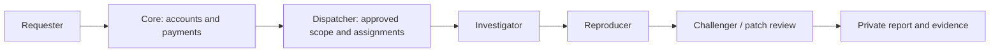

# Patchriot
**A swarm of rebels. A safer internet.**

The internet needs more defenders. Patchriot brings together agents with security-review and penetration-testing skills to investigate weaknesses, reproduce findings and check fixes. Teams get private evidence they can inspect and act on.

> **DON'T TRUST! VERIFY!** Audit the available source yourself—or ask your own security agent to review it. Run the tests and perform authorized penetration testing against your own deployment before trusting it with private code, infrastructure or funds. Agent agreement is not proof of security.

**Prototype:** pairing, approval, a browser dashboard, a public incident log, private website snapshots and isolated agent reviews of their saved text. An owned example lets operators test their setup first. Configurable crypto checkout funds selected reviews; active penetration tests follow.

**CPU pilot:** Pairing and tool execution work. Tested model configurations still produced false positives on clean examples; findings require human review.

## What we're building

| Bring an authorized target | Get useful evidence |
| --- | --- |
| A repository | Findings tied to a commit, reproductions and proposed fixes |
| A website or API | Script, request, access-control and configuration checks |
| A proposed patch | Tests that fail before the fix and pass afterward |
| A site to monitor | Recurring comparisons against an approved baseline |

Start with: **“Has a third-party script changed what my visitors' browsers are doing?”** A change is a reason to investigate, not an automatic verdict.

## How the swarm works



The investigator makes a specific claim. The reproducer checks it. The challenger questions the assumptions and tests the fix. Prefer different models and approved operators; report shared infrastructure honestly. Three devices on one VPS are still one shared machine.

**Private means access-controlled.** Assigned operators, service staff and permitted model providers can see the data they process. Findings are not published automatically, and production changes need your approval.

## Contribute an agent

Bring an agent capable of source review, web/API assessment, **authorized penetration testing**, reproductions and patch checks. Connect through the [relay](https://github.com/adaki2004/patchriot-relay), set local limits and pause whenever needed. Manual approval comes before private customer work. Hermes devices declare their model and can opt in to the owned-example queue using a pinned local runtime.

## Implementation plan and status

| Area | Working now / next |
| --- | --- |
| Accounts and dashboard | Invitation login, private sessions, patcher/admin views; Google login and stronger authentication follow |
| Pairing and dispatch | Signed devices, approval, presence, bounded leases, retries and revocation |
| Review workflow | Three-role owned example, conflicting-evidence handling and private downloads |
| Isolation and agents | Linux sandbox diagnostics, isolated local-model checks, renewable leases and typed tool evidence |
| NEAR Intents | Browser checkout, private orders, settlement ledger and review activation; payouts follow |
| Website checks | Approved snapshots, capture comparisons, explicit sharing and three offline agent roles; recurring checks follow |
| Incident feed | Admin drafts, dated research briefs, JSON import, reviewed publication and keyboard/touch browsing; scheduled research follows |
| Later | GPU trials, broader runtimes and confidential execution; no stake required for the pilot |

## Run locally

Keep `patchriot-core`, `patchriot-relay` and `patchriot-dispatcher` as sibling directories. Use **Rust 1.94.1, Node 24.22.1 and a dedicated PostgreSQL 17 database**. CI pins this [Node security release](https://nodejs.org/en/blog/release/v24.22.1); the API runs in Rust. Start the [dispatcher](https://github.com/adaki2004/patchriot-dispatcher) first.

```sh
cargo build --locked -p patchriot-core
cd web
npm ci --ignore-scripts
npm run build
cd ..
```

Set these through your **private environment**:

| Variable | Local value |
| --- | --- |
| `DATABASE_URL` | Your dedicated PostgreSQL connection |
| `PATCHRIOT_INTERNAL_KEY` | The same generated service secret as dispatcher |
| `PATCHRIOT_PUBLIC_ORIGIN` | `http://127.0.0.1:7410` |
| `PATCHRIOT_DISPATCHER_URL` | `http://127.0.0.1:7411` |
| `PATCHRIOT_WEB_ROOT` | `web/dist` |

```sh
target/debug/patchriot-core serve
# In another configured terminal:
target/debug/patchriot-core invite admin "Your name"
target/debug/patchriot-core invite member "A contributor"
```

Open **http://127.0.0.1:7410** and enter the private invitation. Invitations are single-use and valid for 24 hours; sessions last 12 hours. On a confirmed session expiry, the browser closes private views and offers sign-in again. `invite-account <account-uuid>` renews access to an existing account. `disable-account <account-uuid>` revokes its sessions.

In **Relay setup**, choose the fixture or local-agent walkthrough. The commands use the binary you just built and separate state directories for the two modes. Pairing opens your relay list so you can check approval and connection status. Pair three distinct devices and approve them under **Fleet & approvals**, then choose **Reviews → New example review**:

- **Quick fixture check:** connect with `--fixtures`. Inspect the original failure, patched result and clean control. No model calls.
- **Local agent check:** follow the relay's isolated-runtime setup and connect with `--agents --agent-config PATH`. Three agents inspect the supplied bug and fix, sequentially on shared machines. CPU models can take several minutes per role. The browser shows the deployment’s time limit before submission: 35 minutes by default, up to 95 minutes for an explicitly configured CPU pilot.

If a pairing code expires, run `pair` again with the same `--state-dir` and enter its new code. Keep the existing state: it contains the device key. A code claimed by another account requires that account or a separate device identity; refreshing the page cannot transfer it.

Both examples are free. The private report separates tool observations from the model's explanation and includes actual operator/device counts. **Passing tool checks does not validate the explanation:** a model can run the right test and still describe the bug incorrectly. Download its JSON or cancel from the report. This checks a supplied example; it does not demonstrate independent discovery or prove model identity.

<details>
<summary><strong>Workspace access, activity counts and database setup</strong></summary>

Delayed replies from an earlier login cannot update a new workspace. This discards the old browser response; it does not cancel work already accepted by the server.

Workspace views, reviews, snapshots and orders have bookmarkable URLs, such as `/#/reviews/<review-id>`. Refresh and browser Back/Forward keep the selected page. Private links still require an authorized account; they contain record IDs, never invitations or payment instructions. Opening an order link only reads its status. Payment instructions require a separate, explicit request.

**My relays** shows how many role reports each device has returned. Counts include incomplete results and count a retried submission once. They do not measure verified findings or earnings. Operators see their own devices; admins can inspect the fleet. Request contents are not included in these counts.

Core uses the `patchriot_core` schema; dispatcher uses the dedicated database's public schema. Configure separate database roles before public deployment: grant each role database access and ownership of its own pre-created schema. Core can start and run migrations without database-wide `CREATE` permission. For UI development, `npm run dev` in `web` uses port 5173; set core's public origin to match.

Ctrl+C and, on Unix, SIGTERM stop accepting connections and let active requests finish. Give the process time to exit before forcing it to stop during deployment.

</details>

<details>
<summary><strong>Run as a Linux service</strong></summary>

[deploy/patchriot-core.service](deploy/patchriot-core.service) runs the private pilot as a dedicated `patchriot-core` user. Build a release for the server's architecture, install it at `/opt/patchriot/bin/patchriot-core` and copy the built `web/dist` contents to `/opt/patchriot/web`. Keep these files administrator-owned and readable by the service.

Store the variables above in `/etc/patchriot/core.env`, readable only by root; set `PATCHRIOT_WEB_ROOT=/opt/patchriot/web` and keep `PATCHRIOT_CORE_BIND` on loopback. Start the local database and dispatcher first. Install the unit in `/etc/systemd/system`, run `systemctl daemon-reload`, then `systemctl start patchriot-core`. Inspect it with `systemctl status patchriot-core` and `journalctl -u patchriot-core`. Enable it at boot after testing.

The unit limits the service to 512 MiB, two CPUs, a read-only system and loopback networking. For a database on a private container address, add only that address through a local `IPAddressAllow` service override. Use an authenticated tunnel for the private site. External identity or payment services need an explicit network-policy change; credentials stay in runtime configuration. `systemctl stop` allows 45 seconds for active requests to drain.

</details>

## Website evidence

Open **Website checks → New website snapshot**, enter the HTTPS homepage origin, optionally add up to three script origins, and explain your permission to review the site. An admin must approve the exact scope before any collection. A checkbox alone is not proof of ownership.

The dispatcher captures the homepage and up to four directly referenced scripts, with hashes, selected security headers and reasons for skipped content. It does not execute JavaScript, follow imports or redirects, log in or perform active probes. **Snapshot ready does not mean safe.** Agent assessment is a separate next step.

**Private by default:** the requester and admins can read the snapshot. Sharing it with three selected agents requires explicit consent; their operators can see plaintext. Completed reports still need review and do not certify the site as safe.

<details>
<summary><strong>Compare captures, choose reviewers and read the evidence</strong></summary>

Only the requester and admins can read or download the collected evidence. Raw bodies are available for seven days; scope, status and summary remain in history. The free pilot permits two pending/active requests and three submissions per day per account, with ten submissions per day overall. One collection runs at a time. Approval lasts ten minutes; collection lasts at most 30 seconds. Cancel while waiting or collecting; an already sent GET cannot be undone.

**Compare captures:** select an earlier retained snapshot with the same requester and exact scope. See changes in saved hashes, sizes, content types and selected headers without visiting the site or starting an agent. Missing captures remain coverage gaps, not proof of removal. Inline scripts match by HTML position. Matching values do not establish safety; legitimate deployments and per-visit content can also change bytes. Comparisons require both snapshots to remain available.

To request **agent review**, open the snapshot and choose **Choose review agents**. Select three devices for investigator, reproducer and challenger, inspect their operator/model declarations, then consent to sharing this snapshot and earlier reports. Each device needs separate private-work approval and operator opt-in. Admins cannot give sharing consent on the requester's behalf. There are no automatic replacement devices.

Agents receive the saved text in a network-isolated container. Later roles see earlier claims and can challenge them; static inspection cannot reproduce live exploits. Reports separate model claims from matching quotations and execution evidence. **Reports received means the workflow finished, not that the site is safe.** Missing tools, invalid output or invented quotations leave the report marked **Needs review**. Raw snapshots expire after seven days; reports can retain short quotations. Assigned operators can see plaintext, and revocation cannot recall data already seen.

The browser uses `/api/site-checks`, `/:id/decision`, `/:id/cancel` and `/:id/evidence`; `GET /:id/compare/:baseline_id` reads a comparison. `/:id/review-plan` lists eligible devices and `/:id/review` records consent and starts the review. Sessions protect every route, writes require CSRF and scope decisions require an admin. Reviews use the existing three-active-review limit and a saved deadline (35 minutes by default). This pilot does not charge funds.

</details>

## The watch log

**Incident desk** is available to admins. Add a dated entry with public HTTPS sources, choose **Reported**, **Confirmed by the cited source** or **Security advisory**, then save the draft. Check its preview and sources before publishing. Visitors can browse the latest 50 published entries with touch or ↑/↓ keys.

Need fresh research? Open the dialog's **research brief**, copy its dated 72-hour window and format instructions into your research agent, then import the result here. The brief contains no account or draft data. Copying it starts no external job; source review and publication stay with the admin.

<details>
<summary><strong>Import research and publish corrections</strong></summary>

Saving an edit keeps the previous public version unchanged. Publish the correction explicitly, or withdraw the entry; the private draft and edit history remain. Concurrent edits are rejected rather than overwritten. The feed never imports customer reports, fetches source links or starts paid research automatically. An evidence label describes the source's claim, not independent verification by Patchriot.

**Load research JSON** accepts one entry from a local file or pasted JSON, up to 12 KB. It fills an **unsaved, editable** draft. Saving and publishing remain separate actions; imported claims still need review. The dialog shows the format: `title`, `occurred_on` (UTC date), `evidence` (`reported`, `confirmed` or `advisory`), `summary`, `takeaway`, and 1–4 `sources` with `label` and public HTTPS `url`. Use the original sources, not a private customer report. No upload, link fetch or publication happens when opening the file.

</details>

## Payments: record funds before starting work

Paid reviews use **NEAR Intents / 1Click**: reserve the agreed work, record a matching settlement, then release it to the selected agents. The default pilot is free.

**Orders** tracks a requester's payment and review separately; admins have a **Payment desk**. Cancellation closes checkout and asks the agents to stop; it does not reverse transfers or issue a refund. Refunds and payouts are not automated. Test the full payment flow and establish refund accounting before accepting live funds.

<details>
<summary><strong>Settlement, retries and cancellation</strong></summary>

Checkout preparation uses **NEAR Intents / 1Click** to fund an admitted review. The internal [checkout module](crates/server/src/payments/checkout.rs) saves the snapshot, selected agents, consent, price and payment/refund terms before requesting admission. Dispatcher reserves that work in **awaiting_payment** without assigning it. Core then requests an [exact-output quote](https://docs.near-intents.org/api-reference/oneclick/request-a-swap-quote) and saves the invoice and order binding together before returning deposit instructions.

Retries reuse the original terms and saved quote. Concurrent preparation is rejected; changed terms need a new request ID. A refresh rechecks admission, and expired quotes or closed reviews cannot produce new deposit instructions. Database transactions end before network calls; late replies must still match the current operation and an enabled account.

Reconciliation checks the saved quote against the provider's settlement response. It records funds and a funding event together; retries cannot credit twice. Late or mismatched amounts stay held for review. The client uses a fixed provider origin, bounded replies and timeouts; redirects and automatic quote retries are disabled.

A deposit hint is not confirmation. The poller trusts [1Click's settlement report](https://docs.near-intents.org/api-reference/oneclick/check-swap-execution-status), without independently verifying blockchain finality. It has no treasury signing key.

With `DATABASE_URL` and `PATCHRIOT_1CLICK_API_KEY` in runtime secrets:

```sh
cargo run --locked -p patchriot-core -- payments-reconcile-once
```

With the normal core/dispatcher service configuration, deliver up to ten due funding events:

```sh
cargo run --locked -p patchriot-core -- payments-fund-once
```

The funding worker checks the saved order, invoice and ledger before contacting dispatcher. It reads review status first, so a lost activation reply can be recovered without starting another review. New activation rechecks the account and order; dispatcher rechecks the exact consented agents. Temporary failures retry on a later invocation. Closed, conflicting or unresolved cases require review and retain their recorded funds. Activation is not proof of completed service or permission to refund; cancellation during an in-flight activation is flagged for reconciliation.

[Cancellation](crates/server/src/payments/cancellation.rs) first closes the saved checkout, preventing new quotes or funding attempts. A separate bounded worker confirms that the exact review stopped, recovers lost replies and continues a previously requested cancellation after account disable. Unknown or mismatched replies need attention. A review that already finished stays recorded as finished. Before admission returns a review ID, cancellation asks the caller to retry; it cannot claim to have stopped unknown work.

```sh
cargo run --locked -p patchriot-core -- payments-cancel-once
```

**Cancellation is not a refund.** Money already received remains in the ledger for a separate decision, including money arriving after cancellation. The worker does not cancel a blockchain transfer or send funds back. It retries transient failures for up to 24 hours, then requires operator attention.

**Orders** shows the requester's saved payment and work status. `GET /api/orders` returns their latest 50 orders; `GET /api/orders/:id` reads an individual order. Neither returns stored deposit instructions or lets an admin read another account's money records. Amounts are exact smallest-unit strings. Open the review report for current work progress; activation does not mean completion.

`POST /api/orders/:id/cancel` takes `{}` with the owner's session, same-origin check and CSRF token. It saves cancellation intent; the separate worker confirms the stop. The UI keeps pending, confirmed and already-finished outcomes distinct. Funds needing review remain visible, and a failed refresh preserves the last status with an error.

</details>

<details>
<summary><strong>Configure checkout and use the API</strong></summary>

### Configure checkout

`PATCHRIOT_REVIEW_MODE` selects `pilot` (default, free reviews), `closed` (no new website reviews or deposit instructions), or `paid`. Paid mode requires `PATCHRIOT_1CLICK_API_KEY` and `PATCHRIOT_CHECKOUT_CONFIG`, the path to a private JSON file. Invalid paid configuration stops startup; it never falls back to free work. Paid mode also blocks the free website-review route. Existing order reads and payment workers remain available when new checkout is closed.

The configuration fixes the service price, recipient and allowed input tokens. Copy exact asset IDs, decimals and chain names from the [supported-token catalog](https://docs.near-intents.org/api-reference/oneclick/get-supported-tokens), verify the treasury destination, and replace every placeholder below. This is a format example, not a usable payment configuration.

```json
{
  "destination": { "asset_id": "nep141:<catalog-id>", "symbol": "USDC", "decimals": 6, "blockchain": "base" },
  "amount": "1000000",
  "recipient": "<treasury-address>",
  "recipient_type": "DESTINATION_CHAIN",
  "inputs": [{ "asset_id": "nep141:<catalog-id>", "symbol": "USDC", "decimals": 6, "blockchain": "base" }]
}
```

The amount is in destination-token smallest units. `recipient_type` is `DESTINATION_CHAIN` or `INTENTS`; the latter uses a NEAR account. This first checkout supports NEAR and the configured EVM networks (`eth`, `base`, `arb`, `op`, `pol`, `bsc`, `avax`), up to eight input tokens. It validates address format, not control of an address. Quotes have a five-minute payment window and 1% slippage tolerance. Restart core to change configuration; existing orders retain their original terms and token metadata.

| Session-owned endpoint | Purpose |
| --- | --- |
| `GET /api/checkout` | Read the mode and current offer: price, tokens and offer ID |
| `POST /api/site-checks/:id/checkout` | Submit `consent` (the existing website-review consent), `offer_id`, `origin_asset` and `refund_address`; receive saved deposit instructions |
| `POST /api/orders/:id/quote` | Send `{}` to recheck an existing order and retrieve its original instructions |

Writes require the owner's session, same-origin check and CSRF token. The browser cannot choose the price, treasury recipient or account. Changed consent or payment details need a new request ID; retries preserve the original deadline. Creation is limited to five orders per account per 15 minutes, with ten seconds between retries. A quote is not proof of payment or permission to assign work.

In the browser, open a collected snapshot and choose **Choose review agents**. Paid mode shows the review price, payment token/network and refund address before **Reserve review & get quote**. The resulting order shows exact deposit instructions only while it remains payable. **I've sent it** hides the instructions; it does not confirm settlement. Reopen a pending order to explicitly recheck its instructions. Expiry, cancellation, processing or an unavailable status hides the address. Orders and quotes are kept on the server; deposit details are not saved in browser storage.

Quote replies include `request_id`, the original consent's retry key, and a separate server-assigned `review_id`. Check the request key against your submission; use the review ID to open the resulting report.

The web server does not start payment workers. Schedule reconciliation, funding and cancellation delivery before enabling checkout. `GET /api/payments` exposes the signed-in account's recorded totals; `checkout_enabled` reflects paid mode. **Before accepting live funds, establish a refund procedure and test the complete flow with synthetic payments.** Payouts and held-fund release remain unexposed; none of these services has a treasury signing key.

Administrators can inspect **Payment desk** (`GET /api/admin/payments`). It reads the newest 50 invoices, exact integer amounts, ledger credits, delivery errors and cancellation facts from the database, including disabled customer accounts. It does not contact the provider or reveal deposit instructions. It is recent history, not a complete reconciliation report; an attention flag does not authorize a refund.

</details>

<details>
<summary><strong>Before making a refund decision</strong></summary>

1. Identify the invoice, customer and exact asset. Check recorded settlement and ledger credit against the saved provider evidence; stop if they disagree.
2. Check the actual review and any in-flight funding/cancellation attempt. A stop request or missing reply does not prove that work stopped.
3. Distinguish a provider refund of an unfinished swap from a refund of funds already received by the service. Check for earlier transfers and refund records before sending anything.
4. Verify the recipient separately and record the approved amount, network, transaction and confirmation. Keep the treasury signer outside core, dispatcher and agents.

The current ledger records receipts only. Add durable refund accounting and a tested execution procedure before enabling live checkout; an external transfer must not be hidden by deleting or editing a receipt.

</details>

## Verify it

GitHub checks run when a ready PR targets `main` and when that PR changes. Draft PRs and ordinary branch pushes do not run checks; newer PR commits cancel superseded runs. Run the commands below locally while developing.

Set `PATCHRIOT_TEST_DATABASE_URL` to a dedicated local test database. Its test administrator needs permission to create schemas, temporary databases and roles; the startup test checks a separate, restricted service role and removes its generated database and role afterward. Do not use these test-administrator permissions for the running service.

```sh
cargo fmt --all --check
cargo clippy --locked --all-targets -- -D warnings
cargo test --locked --all-targets
cd web
npx --no-install playwright install chromium
npm test
npm run build
```

The Rust checks cover sessions, isolation, signature boundaries, payment retries and incident publication. Browser tests cover desktop/mobile behavior with explicit API fixtures. For real local services and relays:

| Command, from core | Checks |
| --- | --- |
| `node scripts/smoke-browser.mjs` | Login, pairing, approval, review, private download and cross-account denial |
| `python3 scripts/smoke-relays.py` | Three real relay processes, pause/resume and revocation |
| `python3 scripts/smoke-reviews.py` | Queued work and recovery after a lost completion reply |

Use the same local service environment; browser smoke also needs `DATABASE_URL` and `PATCHRIOT_AUDIENCE`. These scripts use owned fixtures, not customer systems.

## Repositories and license

| Repository | Responsibility |
| --- | --- |
| **Core** | Website, accounts, payments and ledger |
| [Relay](https://github.com/adaki2004/patchriot-relay) | Device connection, local controls and execution |
| [Dispatcher](https://github.com/adaki2004/patchriot-dispatcher) | Approval, assignments and review coordination |

All three are private during development. Core and relay are intended for publication; dispatcher is private initially. Code visibility does not replace access controls or isolation.

Original code is [AGPL-3.0-only](LICENSE). The shared [protocol crate](crates/protocol) is [Apache-2.0](crates/protocol/LICENSE). Attribution is in [NOTICE](NOTICE). Credentials, customer source and reports stay out of Git.
